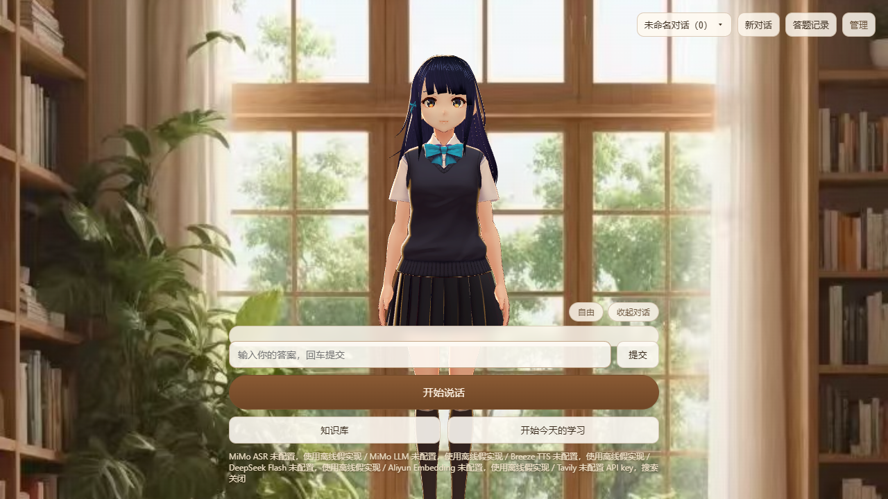
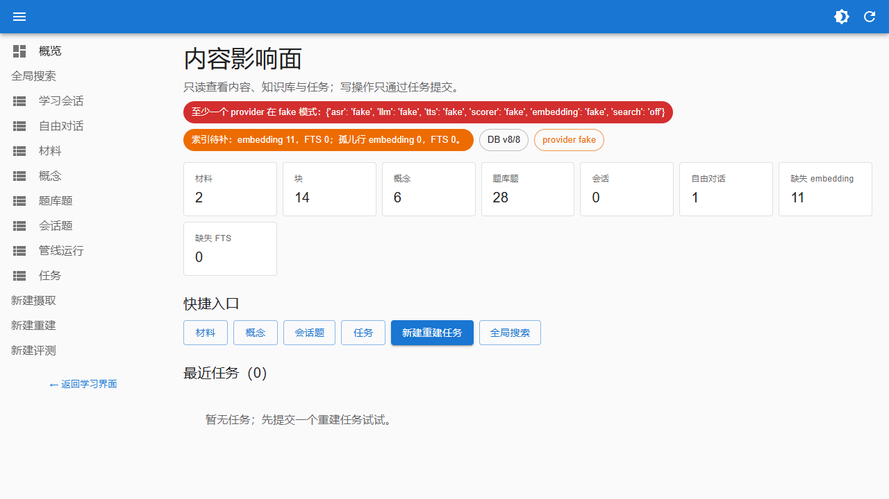

# MOMO 学习搭子 v1.0.0

MOMO 是一个本地优先的 AI 学习搭子：材料经摄取成为带出处的知识，开始学习时按「最近失手 → 掌握度最低」
选题，一场 5 题逐题评分；自由对话可查本地知识库，必要时联网搜索。语音与 3D 形象随仓库分发。



**English** — MOMO is a local-first AI study companion. Feed it your notes, get cited knowledge,
study in 5-question units with per-answer scoring, and talk freely with retrieval-backed answers.
A 3D digital human (VRM), voice input and an admin console ship with the repo. Runs offline with the
bundled demo content — no API key required. Python + FastAPI, SQLite/FTS5, three.js, Docker.

1.0.0 的四个里程碑：

- **学习单元与进度驱动选题**：开始学习先找最近失手、再找掌握度最低；一场 5 题，开场说出提议，结算更新 mastery。
- **Agent Harness 与工具规格契约**：对话/教学/澄清改为有界 agent 回合；17 个工具、8/4/60 预算、A/P/U 结果分离；默认关闭。
- **MOMO 数字人**：可编辑设定集 + 生活池；情绪 comfort/energy 半衰期；用户长期记忆；表情与待机动作。
- **管理后台与学习闭环交互**：react-admin 替换手写后台，三类长任务走任务号轮询；手动下一题、重答覆盖、分句语音、24 小时答题记录。

首次启动用仓库自带的 `demo/` 公开样例建库：2 份笔记、6 个概念、28 道题，覆盖「工具调用」与
「RAG 检索」两个主题，不依赖任何 API key。换成自己的材料见「换成自己的材料」。

## 跑起来（三步）

```bash
# 1. 装依赖（Windows 用 .venv\Scripts\activate；macOS/Linux 用 source .venv/bin/activate）
python -m venv .venv
.venv\Scripts\activate
pip install -r requirements.txt

# 2. 起服务
python -m uvicorn bff.main:app --port 8000
```

```bash
# 3. 打开地址
# http://127.0.0.1:8000
```

验证：打开 http://127.0.0.1:8000/health ，应看到 `{"ok": true, "version": "1.0.0"}`。
8000 被占用就换 `--port 8765` 并访问对应地址。

不需要 `.env`：没有配置任何 key 时 `PROVIDER_MODE=auto` 自动退回离线假实现，
界面与 `/health` 都会标注哪些服务是假的。要接真实服务时 `cp .env.example .env` 再填 key。

## Docker（一条命令）

```bash
docker compose up --build
```

打开 http://127.0.0.1:8000 。镜像里已经构建好管理后台，`/admin/` 直接可用；
`data/`、`materials/` 通过 volume 持久化，重建容器不丢数据；`.env` 存在时由 compose 注入。

拉不到 `node:22-slim` / `python:3.14-slim` 时（国内直连 Docker Hub 会被拦截），
在 Docker Desktop → Settings → Docker Engine 的 `registry-mirrors` 里加一个可用镜像站，再 Apply & restart。

## 换成自己的材料

材料放 `materials/`，走正常管线（需要 DeepSeek 与 embedding key）：

```bash
python -m core.ingest materials/你的笔记.md --emit-chunks
python -m core.extract data/candidates/<时间>.chunks.json
python -m core.confirm data/candidates/<时间>.candidates.json
python -m core.reindex
```

确认后 `concepts.yaml` 与 `seeds/question_bank.json` 落在项目根，默认启动就读它们，
不会再加载 `demo/`。也可以把内容放在别的目录，用 `CONTENT_DIR` 指过去。

## 管理后台



管理后台用 react-admin，源码在 `admin-ui/`，构建产物输出到 `web/admin/`，由同一个 BFF 在
`/admin/` 托管。Docker 镜像已自动构建；本地跑需要自己构建一次：

```bash
cd admin-ui
npm ci
npm run build

cd ..
python -m uvicorn bff.main:app --port 8000
```

打开 http://127.0.0.1:8000/admin/ 。开发时可 `cd admin-ui && npm run dev`，Vite 在 5173，
`/api` 代理到 8000。

- 构建产物不提交；`web/admin/index.html` 缺失时 `/admin/` 返回 503 构建提示。
- 摄取页支持拖拽上传 `.md` / `.html` 到 `materials/inbox/`；不覆盖同名文件，单文件 ≤10MB。
- 摄取页可扫描 `materials/` 下的新增/变更文件，按 `path + content_hash` 对比，勾选后批量提交摄取任务。
- 内容资源只读；DB 写入只通过 `POST /api/admin/tasks` 提交，三类长任务用任务号轮询。
- 任务执行器默认在非 fake 模式开启；fake 模式默认关闭，可显式 `ADMIN_TASK_RUNNER=on` 测试。
- schema v7 → v8 迁移前先备份 `data/app-v5.db`。

## 目录

```
bff/         FastAPI：WebSocket、静态资源、会话、外部 API 编排
  providers/ 各外部服务的适配器（真实 / 离线假）
  probe.py   连通性与延迟探针
core/        领域层，不联网：端口协议、检索、出题契约、评分、会话规则
admin-ui/    react-admin 源码；npm run build 输出到 web/admin/
web/         单页前端：VRM 渲染、按住说话、幅度口型、题型与出处
web/vendor/  three.js 与 three-vrm（随仓库分发，离线可用）
demo/        公开样例内容：materials/ + concepts.yaml + seeds/question_bank.json
assets/      avatar.vrm（CC0，随仓库分发）
docs/designs 冻结设计、评审记录、ASR 测试集、探针报告
```

## 三种运行模式

| `PROVIDER_MODE` | 行为 |
|---|---|
| `auto`（默认） | 配置了 base_url 的服务真实调用；没配置的退回 fake 并给出警告 |
| `real` | 要求的服务必须配置，缺一个就启动失败（不静默造假）；探针可用 `--only` 缩小范围 |
| `fake` | 全部离线假实现，只看链路 |

界面/健康检查会显示是否处于假模式。真实结果才允许写进冻结规格的待定区。

## 真实 provider

| 服务 | 接口 | 鉴权 | 默认模型 |
|---|---|---|---|
| MiMo LLM | `https://api.xiaomimimo.com/v1/chat/completions` | `api-key` 或 Bearer | `mimo-v2.6-flash` |
| MiMo ASR | 同一个 `/chat/completions`，`input_audio` data URI | 同一把 MiMo key | `mimo-v2.5-asr` |
| Breeze TTS | `https://api.breeze.blue/v1/text-to-speech/{voice_id}` | `xi-api-key` | `breeze-tts-2` |
| DeepSeek Flash | `SCORER_BASE_URL` 的 `/chat/completions`（OpenAI 兼容） | Bearer | `SCORER_MODEL`（如 `deepseek-chat`） |
| Tavily 搜索 | `https://api.tavily.com/search` | Bearer | — |

配置写在 `.env`（gitignore）：

```ini
MIMO_API_KEY=...
BREEZE_API_KEY=brz_...
TTS_VOICE=voc_...
SCORER_BASE_URL=...
SCORER_API_KEY=...
SCORER_MODEL=deepseek-chat
EMBEDDING_BASE_URL=...
EMBEDDING_API_KEY=...
TAVILY_API_KEY=tvly-...
```

`LLM_KIND=mimo`、`ASR_KIND=mimo_asr`、`TTS_KIND=breeze` 是默认值；改成
`openai_compat` / `openai_audio` 可以接别的 OpenAI 兼容服务。

`SEARCH_KIND=tavily` 时联网搜索是可选增强：没有 `TAVILY_API_KEY` 就
`search=off`，自由对话只查本地材料，不会阻止启动。搜索 query 会发给
Tavily；结果只作自由对话的来源，不进入知识库、热项或计分题出处。

## d0a：连通性探针

```bash
python -m bff.probe --mode real --only llm,asr,tts --repeat 3
```

它会依次测：

- MiMo LLM：首 token 延迟、总延迟、每秒字数
- MiMo ASR：整段转写的延迟（优先用 `docs/designs/asr-test-set/audio/` 里的 WAV/MP3，没有就合成提示音）
- Breeze TTS：整段合成延迟、流式首包与总时长、音频 mime
- DeepSeek Flash：按评分契约返回 JSON 的可解析率与延迟（`--only` 不含它时跳过）

报告写到 `docs/designs/api-probe/<时间>.md` 与 `.json`。真实数据确认后，按
`docs/designs/FREEZE.md` 的变更规则更新待定区与新哈希。

## d0 语音验收：20 句术语准确率

按 `docs/designs/asr-test-set/manifest.md` 录好 20 句后：

```bash
python -m bff.asr_eval --mode real
```

逐句打印转写与缺失术语，按"目标术语逐字包含"计算准确率，门槛 80%；
报告写到 `docs/designs/asr-test-set/report-<时间>.md`。没有录音时直接提示并退出。

## 3D 形象

仓库自带 `assets/avatar.vrm`（Sendagaya Shino，CC0），开箱即为 MOMO 形象。
换形象：把新的 VRM 放到该路径，刷新页面即可；没有文件时用程序化占位形象。
许可证与来源见 `assets/README.md`。口型是幅度驱动（跟着 TTS 响度开合），不是音素级。

## WebSocket 协议

客户端 → 服务端：

```json
{"type": "audio", "data": "<base64 wav>", "sample_rate": 16000, "mime": "audio/wav"}
{"type": "text", "text": "..."}
{"type": "session_start", "kind": "daily"}
{"type": "answer", "session_id": "...", "question_id": 1, "text": "..."}
{"type": "skip", "session_id": "...", "question_id": 1}
{"type": "finish", "session_id": "..."}
{"type": "ping"}
```

服务端 → 客户端：`ready`（含假模式标记）、`transcript`、`reply_start`、`delta`（流式增量）、
`reply`（全文 + base64 音频 + 各段耗时 + `松手到出声`）、`pong`、`warning`（降级为纯文字）、`error`。

会话事件：`session_ready`、`question`（带 `question_type`，作答前不带出处）、`score`
（带 `question_type`、`source_url`、`source_excerpt`）、`session_result`（逐题带题型与出处）。
生成失败回退旧题库时，`question.origin` 为 `fallback`，前端显示“旧题回退”。

## 出题与评分验收

```bash
# 导出 2 场共 10 题 + 盲评表（隐藏模型声称的题型）
python -m core.eval_questions --prepare --out docs/designs/review-<日期>

# 人工填好 labels-template.json 后，计算四项通过率并落 question-acceptance.md
python -m core.eval_questions --score --out docs/designs/review-<日期> --labels <labels.json>

# 导出 10 条标准答案模板；人工写答案与档位后跑真实评分
python -m core.eval_scoring --prepare --questions <questions.json> --out docs/designs/review-<日期>
python -m core.eval_scoring --run --answers <answers.json> --out docs/designs/review-<日期> --mode real
```

验收工具不进入日常会话路径，不自动改提示词或人工标签。

## 测试

```bash
pip install -r requirements-dev.txt
python -m pytest -q
```

## 当前缺口

- 出题验收：10 题已生成（`docs/designs/review-20261125/`），人工盲评标签未填；题型/理解/业务视角/溯源四项通过率未定。
- 评分验收：10 条标准答案模板已导出，人工档位与答案未填；同档一致率与跳题行为未跑正式报告。
- 新概念先进 `proposed`：只有在确认流程里选了「要学」才转 `active`，选题器也只从 `active` 里挑；未确认的概念不会进入日常推进。
- 外部补充出题（搜索/抓取/热项）本轮不做，规则见 `docs/adr/0002-no-external-supplement-for-scoring-questions.md`。
- ASR 80% 术语准确率：待实测；`docs/designs/asr-test-set/` 的 20 句录音未录。
- BFF 与前端仍用 TTS 整段合成播放；`breeze.py` 的 `stream()` 已实现，但 `audio_chunk` 端到端播放（T6）未接。
