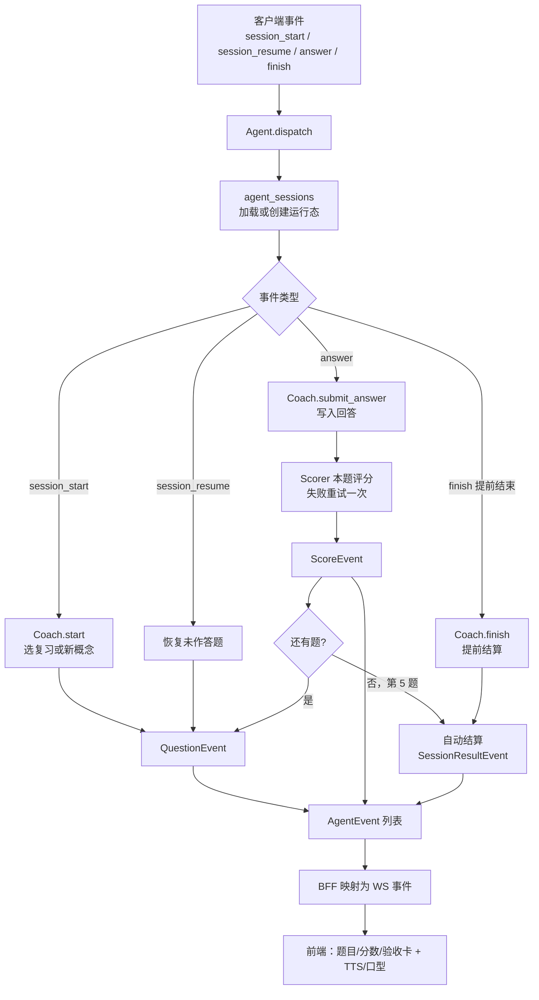
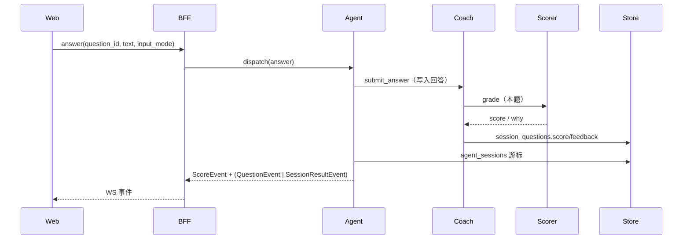
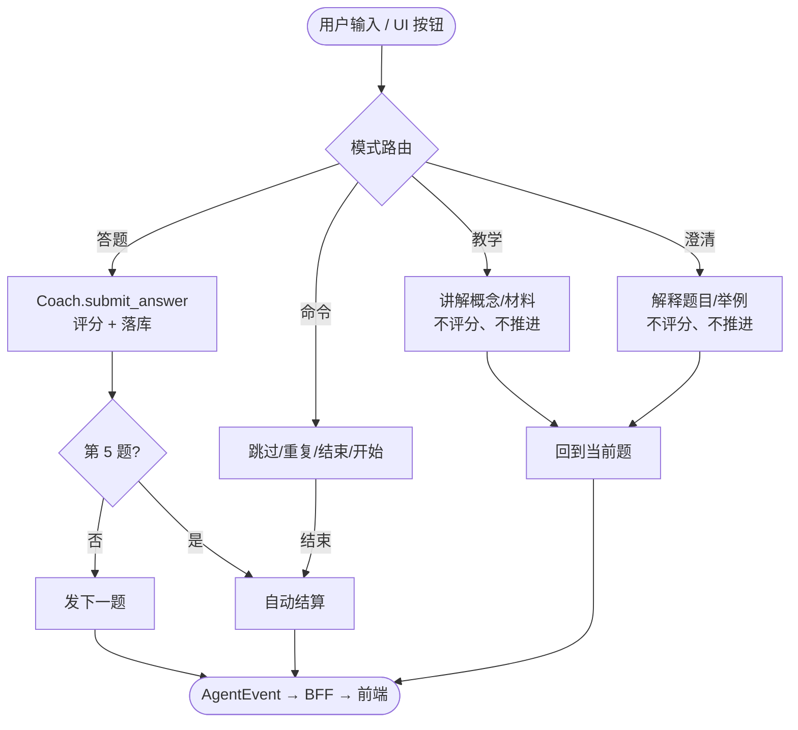

# Agent 基础设施设计 v0.1

- 状态：DRAFT v0.1（2026-11-23）
- 父设计：`docs/designs/learning-companion-digital-human-v2.0.md`（FROZEN 2026-11-23）
- 实现计划：`docs/designs/technical-plan-v0.1.md`（DRAFT）
- 范围：只覆盖 agent 运行时——会话编排、考评、存储、事件契约。VAD/TTS 归 d0；知识入库归 `knowledge-ingestion-v0.1.md`，知识检索归 `knowledge-retrieval-v0.1.md`。
- 版本管理：`docs/designs/VERSIONS.md`

## 1. 要解决的具体问题

### 1.1 表面问题

现在的 d0 是一个**自由对话机器人**：收到一句话就即兴回复，没有议程、没有题库、没有评分、没有记忆。它能证明语音链路通了，但跑不了产品要求的“每天 20 分钟 → 五道题 → 当场验收 → 次日复习”。

### 1.2 三个不同性质的问题

**① 协议问题：多轮会话需要可执行、可恢复的状态机**

“复习优先、五题配比、先问误解、最后结算”是硬约束。自由 LLM 每次都可能给出不同顺序，BFF 也不知道当前该问第几题。需要把“谁决定下一步”从模型手里拿走，交给确定性的 Coach；模型只负责它擅长的部分（反馈措辞、开放题评分）。

**② 考评问题：学习产品需要可比较、可审计的分数**

“感觉讲得不错”不能变成掌握度。必须把题目、你的原文回答、评分、为什么、会话结算全部落库，才能算 mastery、排复习、复盘误解。考评不是链路末端的一个节点，而是**跨会话回路的反馈边**。

**③ 基础设施问题：五个外部能力，任何一个失败都不能丢数据**

ASR、LLM、TTS、Scorer、未来的检索，是五个独立故障域。现在的 d0 把它们直接串在 WebSocket 循环里；一旦评分失败、TTS 超时、ASR 识别错，会话状态就散在前端和内存里。需要统一端口、事件协议、降级规则和存储边界。

### 1.3 为什么是现在

- d0 已验证 MiMo LLM / MiMo ASR / Breeze TTS 三项真实 API 连通和半双工语音。
- POC 暴露交互链路需要改成“点击收音 + VAD 判停”；v2.0 已冻结该调整。
- v0 的缺口不是“再接一个模型”，而是**教练内核 + 考评回路 + 存储**；这三样都属于 agent 基础设施。

### 1.4 明确不解决

- 不做自主 ReAct / 多工具规划（v0 的“工具”是固定步骤，不是模型自选）。
- 不做多用户、账号、云端部署。
- 不做打断 / 回声消除（半双工保留）。
- 不做每轮联网检索（联网只做材料入口）。
- 不做音素级口型。

### 1.5 问题陈述

> 当前数字人是一个无状态的自由对话机器人，无法执行“每天 20 分钟、五题、当场评分、次日复习”的教练协议。agent 基础设施要解决的，是把会话议程、考评与记忆从自由生成中剥离出来：用确定性的会话状态机保证流程，用落库的题目/答案/评分保证可审计，用统一端口与事件协议保证五个外部能力故障时会话不丢数据。模型只保留两件事：生成反馈文本、给开放题打分。

## 2. 用户可感知的变化

### 2.1 使用体验

| 场景 | 现在（d0） | 实现后（v0 基础设施） |
|---|---|---|
| 打开页面 | 空白对话，等你先说话 | 它先念今日任务/第一题，显示 5 题进度和 20 分钟计时 |
| 首次使用 | 直接进入自由对话 | 直接进入初始界面：可自由对话或开始今天的学习；新概念从 `mastery=0` 开始 |
| 说话 | 按住说话，松手才识别 | 点一下开始收音，VAD 切句/判停；它说话时麦克风关闭 |
| 回答 | 直接送 LLM，不保存 | 每题落库，**立即评分并念出分数 + 一句为什么** |
| 中途提问 | 被当成答案送 LLM | 进入教学/澄清模式，**不评分、不推进**；讲完回到当前题 |
| 控制 | 只能关页面 | 说“跳过 / 重复 / 结束 / 开始”或点按钮，按命令执行 |
| 结束 | 没有结束流程 | **第 5 题答完自动结算**；提前结束可点“结束本次”，记 `partial` |
| 第二天 | 从零开始 | 先出到期复习题（v0 最多 2 道，只做次日），再进入新概念；掌握度和下次复习日期可见 |
| 出错 | 报错或静默 | ASR 失败切文字、TTS 失败只显示文字、单题评分失败记该题未评分并继续，答案不丢 |
| 复盘 | 无 | 档案页：错题（<60）、待巩固（60-79）、最近 30 天完成数、每概念掌握度 |
| 自由对话 | d0 唯一模式 | 初始界面常开；进入会话后不参与五题与评分 |

### 2.2 开发 / 复盘体验

- **一个会话可完整回放**：`sessions → session_questions → score/feedback`，不靠日志猜。
- **内容与代码分离**：加概念改 `concepts.yaml`，加题改 `seeds/question_bank.json`，不碰 Coach。
- **状态机可断言**：五题配比、mastery、review_due、结算事务都有测试；`unscored` / `partial` 是明确状态，不是异常堆栈。
- **语音层可替换**：VAD、TTS 流式都挂在固定 WS 事件后面；换 ASR 或换 VAD 不影响会话逻辑。

### 2.3 v0 不承诺

- 不重问误解：v0 只把误解写成 `candidate`（一场最多 1 条），档案可见，重问在 v2。
- 不做综合场 / 复讲场（v2）。
- 不做自主工具规划、每轮联网检索（检索在 v1，联网只做材料入口）。
- 不做打断 / 回声消除（半双工保留）。
- v0 复习只做“次日 / 清空”，完整区间（60-79 三天、14 天循环）留 v2。
- 评分用 DeepSeek Flash（2026-11-23 已接通）；先做 10 条人工对照 smoke，20 条完整校准是 v0 之后的独立 gate；校准前分数只作流程验证。

## 3. 影响范围

### 3.1 代码边界

| 模块 | 归属 | 说明 |
|---|---|---|
| `core/coach.py` | 本文档 | 会话状态机、五题配比、mastery、review_due、结算 |
| `core/agent.py` | 本文档（新增） | 最小回合编排：收到事件 → 调 Coach/Scorer → 产出 AgentEvent；不写业务规则 |
| `core/store.py`、`core/db.py` | 本文档 | 运行时状态、写边界、幂等、事务 |
| `core/planner.py`、`core/tutor.py`、`core/scoring.py` | 本文档（扩展） | 选题、反馈模板、评分编排（解析已存在） |
| `core/seed.py`、`concepts.yaml`、`seeds/` | 接口 + 种子 | 内容装载属于本文档；内容本体、材料、切块归 `knowledge-ingestion-v0.1.md` |
| `bff/main.py` | 本文档 | WS 事件协议、Agent 接入、错误/降级映射 |
| `web/` 会话 UI | 部分 | 只定义所需事件与状态（题目、进度、验收卡）；视觉/3D 不在本文档 |
| `bff/providers/*` | 只定端口 | ASR/LLM/TTS/Scorer 的协议与降级；具体适配器不在本文档展开 |
| VAD / 流式 TTS | 否（接口） | 传输层，归 d0/P1；本文档只约定 `audio` / `audio_chunk` 事件 |
| 材料解析、切块、联网 | 否 | `knowledge-ingestion-v0.1.md`；本文档只留边界 |
| 检索、embedding、FTS | 否 | `knowledge-retrieval-v0.1.md`；本文档只留 `Retriever` 端口和“v0 不实现”的边界 |
| 多用户、云、鉴权、打断/AEC | 否 | 明确非目标 |

### 3.2 数据边界

- **内容存储（文件）**：`concepts.yaml`、`seeds/question_bank.json`、`materials/`。`materials/` 运行时只读；`concepts.yaml` 仅在出处确认后更新 `source`；`seeds` 由审核通过的自动回灌写入（KB-15/KB-18/KB-19）。改内容不改代码。
- **运行时存储（可写）**：`data/app.db`。只有 `core/store.py` 能写。
- **传输态（内存）**：当前 WebSocket 连接的对话历史、未播音频。v0 不持久化；会话运行态由 `agent_sessions` 承担。
- **不新增**：不引入 Redis、消息队列、独立向量库；单机 SQLite 足够。

### 3.3 对已冻结文档的影响

- v2.0 已 FROZEN，本文档是它的子设计；冲突以 v2.0 为准。
- 本文档新增 `agent_sessions` 表，属于对 v2.0 数据模型的**追加变更**；实现前在 `FREEZE.md` 记录原因、影响章节和新哈希。
- `technical-plan-v0.1` 继续作为实现顺序；本文档细化 agent 运行时，不重复它的材料/检索部分。

### 3.4 测试与验收边界

- 本文档必须落地：五题配比五种组合、mastery 最近三次、review_due 区间、结算事务、ASR 降级、评分故障 `unscored`、Coach 主流程、`agent_sessions` 生命周期。
- 不测：VAD 准确率、TTS 音质、3D 口型精度（d0）、检索召回（`knowledge-retrieval-v0.1.md`）。

### 3.5 运维边界

- 单机、单用户、本地 `data/app.db`；WAL；无迁移框架，`SCHEMA_VERSION` + `user_version`。
- 备份 = 停 BFF 后复制 `data/app.db`（WAL 下运行中只复制主文件会漏 `-wal`）；演示 = `data/demo/`；清空只删演示目录。
- 失败可见：`unscored` / `partial` / provider warning 都进协议，不靠日志猜。

## 4. 设计决策记录

规则：

- 只追加，不改历史结论；被推翻的旧条目保留，标 `superseded by AI-xx`。
- ID 用 `AI-01…`（本文档）、`KB-01…`（入库文档）、`KR-01…`（检索文档），避免与 v2.0 的 D3-D8 撞号。
- 每条写：日期、决策、背景/问题、备选方案、影响、状态。
- 与 v2.0 重复的只写“继承 v2.0 Dx”，不重复论证。
- 状态只有 `accepted` / `superseded` / `revisit`。

| ID | 日期 | 决策 | 背景 | 备选 | 影响 | 状态 |
|---|---|---|---|---|---|---|
| AI-01 | 2026-11-23 | 主线是“教练会话的可执行与可复盘” | d0 自由对话跑不了五题/考评/记忆 | 自主 agent / 语音体验 / provider 接入 | 状态机、评分、存储优先 | accepted |
| AI-02 | 2026-11-23 | 验收第一优先是“流程感” | 没有议程就没有产品形态 | 记忆感 / 可靠感 / 可维护性 | 先做开场→逐题→验收卡 | accepted |
| AI-03 | 2026-11-23 | 只覆盖 agent 运行时 | 知识库与语音要独立成文档 | 连语音 / 连知识库 / 全栈 | VAD、检索只定端口 | accepted |
| AI-04 | 2026-11-23 | 决策记录放文档内表格，ID 用 AI/KB 前缀 | 复盘要能回答“为什么当时这么定” | 独立 ADR / 只留结论 / gstack | 文档自带决策日志 | accepted |
| AI-05 | 2026-11-23 | 新增 `agent_sessions` 运行表，`sessions` 只存最终结果 | 断线会留下没有 sessions 行的孤儿题 | 内存会话 / sessions 加 in_progress / 事件溯源 | 运行态与结果分离；需 FREEZE 追加记录 | accepted |
| AI-06 | 2026-11-23 | Agent 是薄外壳，Coach 仍掌全部业务规则 | 不能出现第二个“大脑”，兼容 v2.0 D7 | Agent 主入口 / 不要 Agent 层 / LLM 自主决策 | Agent 只管生命周期与事件翻译 | accepted（继承 v2.0 D7） |
| AI-07 | 2026-11-23 | v0 不做事件溯源，`agent_sessions` 只存生命周期与游标 | 事件表写入量与复杂度高，与“agent 最简单”冲突 | `agent_events` 逐回合追加 | 复盘靠 `session_questions`；v1 再评估 | accepted |
| AI-08 | 2026-11-23 | v0 评分用 DeepSeek Flash（`https://api.deepseek.com/v1`，`deepseek-chat`） | 2026-11-23 探针 3/3 可解析，平均 979ms | fake / MiMo 代打 / 等接口 | 逐题真实评分；校准另设 gate | accepted（2026-11-23 更新） |
| AI-09 | 2026-11-23 | 半双工保留；收音改为点击 + VAD 判停 | POC 发现按住说话不自然 | 按住说话 / 全双工打断 | 交互更自然，不引入 AEC | accepted（继承 v2.0 P1） |
| AI-10 | 2026-11-23 | 正式评分逐题即时；单题失败重试一次，仍失败该题记未评分并继续 | 逐题反馈需要分数；整场作废会毁掉 20 分钟 | 结束批量 / 单题失败整场作废 / 本地估分 | `session_score` 按已评分题均值；5 题都评分才 completed，否则 partial；零评分 unscored | accepted |
| AI-11 | 2026-11-23 | 第 5 题答完自动结算；保留“结束本次”用于提前结束 | 自动结束顺手，但 partial 需要入口 | 只自动 / 只手动 / 超时 | 事件顺序 `score` → `session_result`；`finish` 只用于提前结束 | accepted |
| AI-12 | 2026-11-23 | v0 包含摸底；逐题评分；存 `session_score` 但不计 30 天完成数 | 不摸底则 mastery 全 0，前置解锁卡住 | 不做 / 只做样例 / 推到 v0.5 | 每个 active 概念 1 题，最多 10；`mastery=round(score/20)` | superseded（AI-24，2026-11-24） |
| AI-13 | 2026-11-23 | 自由对话移到独立配置开关，默认关闭 | 保留在同一会话会绕过五题与评分 | UI 开关 / 调试路由 / 完全移除 | 配置开关控制 d0 路径；每日会话仍以 Coach 为唯一入口 | superseded（AI-25，2026-11-24） |
| AI-14 | 2026-11-23 | 逐题只写 score/feedback；mastery/review_due 在结算时更新 | 每题更新会让中途退出留下半更新状态 | 每题更新 / 每 5 题批量 / 不更新 | 两段式写入不变；结算仍是单事务 | accepted |
| AI-15 | 2026-11-23 | 同一本地日期内 active 可恢复；跨日置 abandoned | 学习日的自然边界是日期，不是小时 | 2 小时超时 / 跨日写 unscored / 不恢复 | abandoned 只留 `agent_sessions`，不写 `sessions` | accepted |
| AI-16 | 2026-11-23 | v0 复习只做“次日 / 清空” | 完整区间留 v2；v0 先保证“第二天先复习” | 写全区间 / 只做清空 / 不做复习 | `review_due_at` 仍存日期；3 天/14 天逻辑 v2 再加 | accepted |
| AI-17 | 2026-11-23 | 反馈用 Scorer 返回的 `why` + 模板，直接 TTS | 再调一次 LLM 只换来口语化，增加延迟与成本 | LLM 改写 / 只显示不念 / 只念分数 | 每题反馈可审计；不额外调 LLM | accepted |
| AI-18 | 2026-11-23 | 误解一场最多落 1 条 `candidate`，按 (concept,key) 去重 | 逐题评分可能一场返回多条，噪声大 | 每题都落 / 不落 / 只落最后一条 | v0 不重问；v2 再做生命周期 | accepted |
| AI-19 | 2026-11-23 | agent 工作区只维护 `tests/fixtures` 种子；真实 `concepts.yaml`/题库归知识库工作区 | 避免两套内容真相源 | agent 建 demo 种子 / 等知识库 / 单概念 fixture | 测试用 3 概念 × 5 题 fixture；真实内容由 KB 文档产出 | accepted |
| AI-20 | 2026-11-23 | v0 验收流程优先；评分校准单列 | 流程与“分数可信”是两个门槛 | 一起验收 / 只验流程 / 全量 v0 | 10 条人工对照 smoke；20 条完整校准作为后续 gate | accepted |
| AI-21 | 2026-11-23 | 模式路由分四类：教学 / 答题 / 澄清 / 命令 | 用户指令；一轮输入可能是讲解、作答、提问或控制 | 只分答题/非答题 / LLM 自主判断 | 路由在 Agent 与 Coach 之间；模式与会话状态正交 | accepted |
| AI-22 | 2026-11-23 | v0 路由用“UI 显式意图 > 精确命令词 > 关键词规则”；歧义先问，不评分 | 每轮 LLM 分类多一次调用且难测；误判教学/澄清为答案会污染分数 | 每轮 LLM 分类 / 只用 UI 按钮 / 状态驱动 | 路由确定、可测；LLM 兜底放 v1 | revisit（默认假设） |
| AI-23 | 2026-11-23 | 教学按需进入（“讲讲/什么是/教我”），讲完回当前题；v0 用 `plain_def` + 出处 + 模板；教学/澄清不落库 | 固定教学段会削弱“先自己讲”；LLM 讲解增加延迟；逐轮落库接近事件溯源 | 固定教学段 / LLM 讲解 / `agent_turns` 逐轮落库 | v0 只存答题轮；教学/澄清只影响当轮 | revisit（默认假设） |
| AI-24 | 2026-11-24 | 撤销摸底：v0 不做诊断场，不做初始 mastery 校准；所有概念从 0 开始 | 实现与冻结版不一致，用户决定按实现收敛 | 保留摸底 / 只做样例 / 移除 | 首批概念必须包含无前置的根概念，否则 Planner 无题可出 | accepted（2026-11-24） |
| AI-25 | 2026-11-24 | 自由对话不设配置开关，初始界面常开；无会话的 `audio` 走自由对话 | 实现无开关；冻结版“默认关闭”与实际不符 | 保留开关 / 完全移除 / 常开 | 有会话仍走答题评分；每日会话仍以 Coach 为唯一入口 | accepted（2026-11-24） |
| AI-26 | 2026-11-23 | v0 只建 6 表；BFF lifespan 里 `connect(data/app.db)` + `init_schema`，加 startup smoke test；KB 4 表与 `agent_sessions` 按各自阶段加法追加 | 数据库有 schema/Store/测试，但没有任何应用调用点，会话仍是纯内存 | 等 Coach 再接 / 现在全量建表 | 集成问题提前暴露；v0 不建投机表 | superseded（AI-30，2026-11-24） |
| AI-27 | 2026-11-23 | `init_schema` 加版本检查与迁移钩子：`user_version=0` 建表、低于当前版本跑迁移、高于当前版本报错；只做加法迁移 | 现在无条件写 `user_version=1`，旧库加列时无法升级 | 保持现状 / 引入 Alembic | 下一次加表就是第一次真实迁移，现在验证成本最低 | superseded（AI-30，2026-11-24） |
| AI-28 | 2026-11-23 | 写路径收紧：应用层保证完整性、暂不加 FK；`import_question_bank`/`sync_runtime` 包单事务；`finalize` 校验 concept/question 存在；`due_reviews` 只查 `active` | autocommit 逐条提交会留下半批；`finalize` 对不存在的 concept 静默 0 行更新；`due_reviews` 返回所有状态 | DB 加 FK / 维持现状 | 失败即报错、写入可回滚；FK 等 `agent_sessions` 落地后再评估 | accepted |
| AI-29 | 2026-11-23 | 备份前停 BFF，再复制 `data/app.db`；不做运行中热备 | WAL 模式下只复制主文件可能漏掉已提交数据 | 加 backup 命令 / 复制 db+wal+shm | 当前单用户本地够用；热备留到需要时 | accepted |
| AI-30 | 2026-11-24 | 合并知识库分支后 `SCHEMA_VERSION=5`；`init_schema` 按表名补齐；`conversation_messages` 加 `sources_json` | progress 的 v3 是 conversations，KB 的 v3 是检索表，版本号无法区分 | 两个 v4 / 重写迁移框架 | 旧库原地可补，新库一次建全 | accepted（2026-11-24） |

## 5. Agent 存储规范

### 5.1 三类存储

| 类别 | 内容 | 真相源 | 可写性 |
|---|---|---|---|
| 内容存储 | `concepts.yaml`、`seeds/question_bank.json`、`materials/` | 文件（进 git） | `materials/` 只读；`concepts.yaml` 仅出处确认后改 `source`；`seeds` 由审核通过的自动回灌写入 |
| 运行时存储 | 会话、题目作答、评分、mastery、复习、误解、运行态 | `data/app.db`（SQLite） | 只有 `core/store.py` 能写 |
| 传输态 | 当前 WS 连接的对话历史、未播音频 | 内存 | 不持久化；断线由 `agent_sessions` 恢复 |

### 5.2 表与归属

| 表 | 归属 | 作用 | 真相源 |
|---|---|---|---|
| `concepts` | 运行时 | mastery/status/last_seen/review_due | YAML 是内容真相，表只存状态 |
| `question_bank` | 内容镜像 | 题库查询缓存 | `seeds/question_bank.json`，全量镜像同步（KB-17） |
| `sessions` | 学习记录 | 一场会话的最终结果 | 结算时写入 |
| `session_concepts` | 学习记录 | 综合场/跨概念讲解的多概念关联 | 结算时写入 |
| `session_questions` | 学习记录 | 逐题证据：题目、回答、分数、反馈、出处 | 逐题 commit |
| `misconceptions` | 学习记录 | 误解 candidate/active/resolved | 评分时写入 |
| `agent_sessions` | **运行时（新增）** | 会话生命周期与恢复游标 | `start` 写入，`finish`/`abandon` 更新 |

`agent_sessions` 是对 v2.0 六表模型的追加，不替代任何现有表：

```sql
CREATE TABLE agent_sessions (
  session_id TEXT PRIMARY KEY,
  kind TEXT NOT NULL CHECK (kind IN ('daily','review')),
  date TEXT NOT NULL,
  started_at TEXT NOT NULL,
  updated_at TEXT NOT NULL,
  status TEXT NOT NULL CHECK (status IN ('active','finished','abandoned')),
  concept_id TEXT,
  last_question_id INTEGER,
  input_mode TEXT NOT NULL DEFAULT 'text'
);
```

### 5.3 约定

- **ID**：`session_id` = UUID4 hex；`concepts.id` = slug；`question_bank.id` 手写题 `<concept>-<kind>-<n>`、生成题 `<concept>-<kind>-<hash8>`（KB-15）；`session_questions.id` = 自增。
- **时间**：`date` / `review_due_at` / `review_started_at` / `last_seen` 用本地 `YYYY-MM-DD`（学习日按本地算）；`created_at` / `started_at` / `updated_at` 用本地 ISO 8601（秒）。
- **写边界**：
  1. `start`：插入 `agent_sessions(status=active)`；逐题插入 `session_questions` 并 commit。
  2. `answer`：调用 Scorer 逐题评分 → 写 `session_questions.score/feedback` → 更新 `agent_sessions.last_question_id/input_mode/updated_at` → commit。评分重试一次；仍失败则该题 `score=NULL`、`feedback='本题未评分'`，会话继续。
  3. 自动结束（第 5 题评分后）或提前结束：单事务更新 `sessions`、`concepts`、`misconceptions`，并把 `agent_sessions.status` 置 `finished`；`session_score` 只对已评分题取均值。
  4. `abandon`：启动时把 `date < today` 的 `active` 会话置 `abandoned`；不删除任何题目行。
- **幂等**：`finish` 以 `session_id` 为幂等键；重复结算返回已有结果，不重复计分。
- **题库镜像**：`import_question_bank` 改为全量镜像同步（一个事务 upsert 所有 seeds 行 + 删除 seeds 中不存在的 id）；seeds 是真相，镜像可重建（KB-17）。
- **不存原始音频**：只存转写文本与置信度；音频不落盘。
- **迁移**：`SCHEMA_VERSION` + `PRAGMA user_version`；只做加法迁移；破坏性迁移前备份。

### 5.4 断线恢复（v0 策略）

- 客户端重连后发 `session_resume`，带 `session_id`。
- 同日且 `status=active`：返回第一道未作答题；没有未作答题时自动结算并返回 `session_result`。
- 跨日或 `status!=active`：返回 `session_expired`，客户端开新会话；旧会话由启动扫描置 `abandoned`。
- `abandoned` 只留 `agent_sessions`，不写 `sessions`，避免污染学习统计。
- 自动恢复只保证“同一天、同一台机器、同一个 WebSocket 重连”；跨设备/跨进程恢复不在 v0。

## 6. 最小 Agent 模块与回合管线

### 6.1 职责边界

| 层 | 职责 | 不做什么 |
|---|---|---|
| Agent（新增，运行时外壳） | 接收事件、加载/更新 `agent_sessions`、调用 Coach、把结果翻译成 `AgentEvent` | 不做业务规则、不碰音频、不调 LLM |
| Coach（已有设计） | 复习优先、五题配比、mastery、review_due、结算 | 不碰 WS、不碰 TTS |
| BFF | WS 传输、ASR/LLM/TTS/Scorer 适配、错误映射 | 不写业务规则、不直接写 SQL |
| Store | 唯一写库入口 | 不做流程判断 |

### 6.2 API

```python
class Agent:
    def start(self, kind: str) -> list[AgentEvent]: ...
    def resume(self, session_id: str) -> list[AgentEvent]: ...
    def answer(self, session_id: str, question_id: int, text: str, input_mode: str,
               *, intent: str | None = None) -> list[AgentEvent]: ...
    async def finish(self, session_id: str) -> list[AgentEvent]: ...
```

`answer` 先过模式路由（`intent` 来自 UI；缺省时按 §6.5 的规则）；只有 `答题` 模式会写答案、评分、推进题目。

`AgentEvent` 只有六种：`question` / `score` / `session_result` / `warning` / `error` / `session_expired`。没有音频、没有 LLM 调用；TTS 由 BFF 根据 `question` / `score.why` 文本生成。

- `answer` 委托 Coach；Coach 调用 Scorer 逐题评分，返回 `ScoreEvent` + 下一题 `QuestionEvent`。
- 第 5 题评分后自动结算，返回 `ScoreEvent` + `SessionResultEvent`，不需要客户端再发 `finish`。
- `finish` 只用于提前结束；返回已评分题的 `ScoreEvent` + `SessionResultEvent(status=partial)`。

### 6.3 回合管线



一次 `answer` 的时序：



### 6.4 明确不做

- 不做自主工具选择 / ReAct / 多步规划。
- Agent 循环里不直接调 LLM；Coach 在 `submit_answer` 里通过 Scorer 端口评分。
- 不碰音频、VAD、TTS；这些是 BFF/前端的职责。
- v0 不接检索；只留 `Retriever` 端口，`knowledge-retrieval-v0.1.md` 再实现。

### 6.5 模式路由（2026-11-23）

一轮输入先经过模式路由，再进入对应处理器。**模式与会话状态正交**：会话状态是 `asking / settling / finished`，模式是“这一轮用户想干什么”。

| 模式 | 典型输入 | 处理器 | 写答案/评分 | 推进题目 |
|---|---|---|---|---|
| **教学** | “讲讲 ReAct”“什么是工具调用”“教我” | 用 `plain_def` + 出处 + 模板讲解 | 否 | 否 |
| **答题** | 直接回答当前题，或点“提交回答” | `Coach.submit_answer` → Scorer | 是 | 是 |
| **澄清** | “这题什么意思”“能举个例子吗”“没听懂” | 解释题目/概念，最多 2-3 句 | 否 | 否 |
| **命令** | “跳过”“重复”“结束”“开始”“随便聊聊” | 控制会话状态 | 视命令 | 视命令 |

**路由优先级（v0）**：

1. UI 显式意图（前端按钮带 `intent`）。
2. 精确命令词（跳过 / 重复 / 结束 / 开始 / 随便聊聊）。
3. 关键词规则（“讲讲 / 什么是 / 教我” → 教学；“这题 / 什么意思 / 没听懂” → 澄清）。
4. 歧义：在答题中且无法判断 → 先问“你是在回答这道题，还是在问概念？”，**不评分**。
5. 默认：有当前题 → 答题；无当前题 → 开始 / 自由对话（初始界面常开）。

**v0 边界**：

- 不做每轮 LLM 分类；LLM 兜底放 v1。
- 教学/澄清不写 `answer_text`、不评分；讲完回到当前题。
- 教学内容用 `plain_def` + `source_excerpt` + 模板；LLM 讲解放 v1。
- 教学/澄清不落库；v0 只存答题轮，复盘靠 `session_questions`。



命令的 v0 词表：

| 命令 | 行为 |
|---|---|
| 跳过 | 当前题留空、不评分，进入下一题；整场可能变 `partial` |
| 重复 | 重播当前题，不改状态 |
| 结束 | 提前结算，按已评分题记 `partial`（零评分则 `unscored`） |
| 开始 | 空闲时开今日任务；会话中不生效 |
| 随便聊聊 | 仅无进行中会话时切自由对话；不参与五题与评分 |

## 7. 事件契约

### 7.1 客户端 → 服务端

- `{"type":"session_start","kind":"daily"}`
- `{"type":"session_resume","session_id":"..."}`
- `{"type":"answer","question_id":123,"text":"...","input_mode":"voice"|"text","intent":"answer"|"teach"|"clarify"|"command"}`（`intent` 可选，UI 显式意图优先）`
- `{"type":"finish","session_id":"..."}`（仅提前结束；第 5 题后自动结算，不需要发）
- 既有 `audio` / `text` 保留：`audio` 先转写，再作为 `answer.text`；`text` 直接作答。

### 7.2 服务端 → 客户端

- `{"type":"session_ready","session_id":"...","question":{...}}`
- `{"type":"question","id":...,"role":"new","kind":"recall","text":"...","options":null,"index":1,"total":5}`
- `{"type":"score","question_id":...,"score":70,"why":"..."}`（每题答完立即发）
- `{"type":"session_result","status":"completed","session_score":78.0,"mastery":{...},"review_due_at":"2026-11-23"}`（第 5 题后自动发；提前结束也发）
- `{"type":"session_expired","session_id":"..."}`
- `{"type":"audio_chunk","seq":1,"mime":"audio/mpeg","data":"<base64>"}`
- 既有 `transcript` / `reply` / `warning` / `error` 保留。

### 7.3 AgentEvent 映射

| AgentEvent | WS 事件 | 说明 |
|---|---|---|
| `question` | `question` / `session_ready` | 含题目、角色、序号、总数 |
| `score` | `score` | 每题分数 + 一句为什么，答完立即发 |
| `session_result` | `session_result` | status / session_score / mastery / review_due；第 5 题后自动发，或提前结束发 |
| `warning` | `warning` | TTS/ASR 降级，不阻塞 |
| `error` | `error` | 协议/服务错误 |
| `session_expired` | `session_expired` | 跨日或非 active，开新会话 |

## 8. 验收与测试映射

### 8.1 流程优先（AI-02）

1. `session_start` 返回第一题，并创建 `agent_sessions(status=active)`。
2. 每次 `answer` 落库、评分，返回 `score` + 下一题。
3. 第 5 题评分后**自动结算**，返回 `score` + `session_result`；`sessions` 有最终结果。
4. 提前结束走 `finish`，返回已评分题的 `score` + `partial` 的 `session_result`。
5. 刷新/重连后 `session_resume` 能回到未答题；没有未答题则自动结算。
6. 数据库可回放：`sessions → session_questions → score/feedback`。

### 8.2 必测

| 行为 | 测试文件 | 断言 |
|---|---|---|
| 五题配比五种组合 | `tests/test_ratios.py` | 每种组合长度 5，角色计数正确 |
| mastery 最近三次 | `tests/test_mastery.py` | 最近三次均值/20；不足三次用已有 |
| review_due 次日/清空 | `tests/test_review.py` | v0：<80 次日、>=80 清空；三天/14 天留 v2 |
| 多概念 due | `tests/test_review.py` | `due_updates` 每概念独立写入 |
| 逐题评分 | `tests/test_coach_flow.py` | 每题答完写 score/feedback；第 5 题后自动结算 |
| 单题评分失败 | `tests/test_coach_flow.py` | 第一次坏 JSON、第二次好 JSON → 成功；两次都坏 → 该题未评分，会话继续 |
| 模式路由 | `tests/test_mode_router.py` | 教学/澄清不评分不推进；命令分发；歧义先问 |
| 结算事务 | `tests/test_session_finalize.py` | 中途失败 → 四张表无半更新 |
| 结算幂等 | `tests/test_session_finalize.py` | 重复结算不重复计分 |
| `agent_sessions` 生命周期 | `tests/test_agent_sessions.py` | active → finished/abandoned；resume 返回未答题 |
| ASR 降级 | `tests/test_ws.py` | ASR 抛错后切文字，会话可继续 |
| 零评分场 | `tests/test_coach_flow.py` | 所有题评分失败 → `unscored`，答案保留 |
| Coach 主流程 | `tests/test_coach_flow.py` | start→answer×5→自动结算，状态与返回值正确 |

### 8.3 手工烟雾

1. 启动服务，`session_start(daily)` → 听到/看到第一题。
2. 点“开始说话”答 5 题 → 第 5 题后自动结算。
3. 点“结束本次” → 逐题分数 + 验收卡。
4. 第二天再开 → 先出到期复习题。
5. 查看 `data/app.db`：`sessions`、`session_questions`、`agent_sessions` 均可回放。

## 9. 开放问题与风险

1. **评分校准**：DeepSeek Flash 已于 2026-11-23 接通（3/3 可解析，平均 979ms），但还没有人工对照。先做 10 条 smoke，20 条完整校准（≥75%）作为 v0 之后的独立 gate。
2. **复习区间口径**：v0 只做“<80 次日 / >=80 清空”；60-79 三天、14 天循环留 v2。技术方案已同步为同一口径。
3. **误解**：v0 一场最多 1 条 `candidate`，按 (concept,key) 去重，不重问；重问在 v2。
4. **`agent_sessions` 是对 v2.0 的追加变更**：实现前必须在 `FREEZE.md` 记录，不能直接改冻结正文。
5. **断线恢复的过期阈值**：同日可恢复，跨日置 abandoned；实测后校准。
6. **VAD 阈值**：300-600ms 短停 / 1.5-2.5s 长停是占位值，属于 d0/P1，不在本文档验收。
7. **事件序列化**：`AgentEvent` 用 dataclass 还是 dict 未定；倾向 dataclass + BFF 显式映射。
8. **种子归属**：agent 只维护 `tests/fixtures`（3 概念 × 5 题）；真实 `concepts.yaml`/题库由知识库工作区产出。
9. **逐题评分延迟**：每题约 1s；若 5 题累计拖慢 20 分钟节奏，再评估“评分与下一题并行”或预评分。
10. **自由对话入口**：不设配置开关，初始界面常开；有会话时只走答题（AI-25，2026-11-24）。
11. **教学深度**：v0 用 `plain_def` + 出处 + 模板；LLM 讲解放 v1。若 v0 就需要“讲得像人”，要加一次 LLM 调用。
12. **命令词表**：v0 只做跳过/重复/结束/开始/随便聊聊；是否需要“上一题/暂停/换一个”待定。
13. **路由 LLM 兜底**：v0 用 UI 意图 + 命令词 + 关键词规则；是否在 v1 引入 LLM 分类、置信度阈值多少，待定。

## 10. 与 v2.0 / 技术方案的关系

- v2.0 是产品与交互的冻结依据；本文档只细化 agent 运行时，不改变产品决定。
- 技术方案 v0.1 是实现顺序与模块表；本文档补充 `agent_sessions`、Agent 外壳与事件契约。
- `knowledge-ingestion-v0.1.md` 负责材料、切块、概念抽取、`concepts.yaml`、题库与联网入口；`knowledge-retrieval-v0.1.md` 负责 embedding、FTS/向量、`Retriever` 与召回验收；本文档只定义 `Retriever` 端口与“v0 不实现”的边界。
- 模式路由是运行时扩展，不改变 v2.0 的每日五题流程；教学/澄清不推进题目、不写入答案。
- 冲突处理：v2.0 > 本文档 > 技术方案；任何改变 v2.0 的硬约束都走 `FREEZE.md`。
