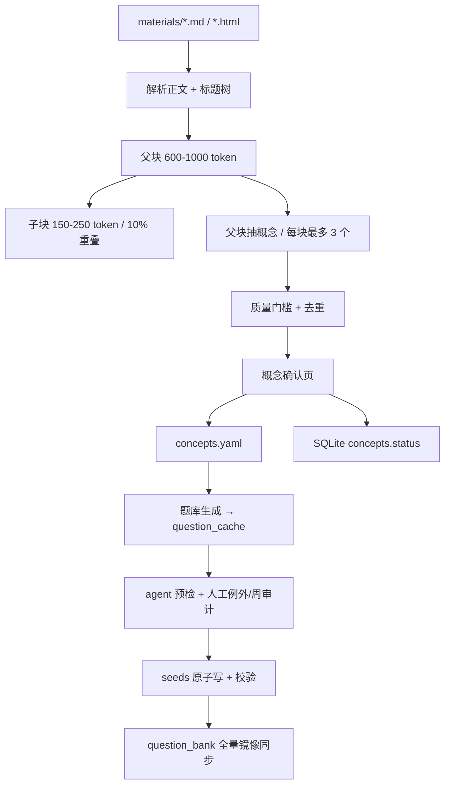

# 知识入库设计 v0.1

- 状态：DRAFT v0.1（2026-11-23）
- 父设计：`docs/designs/learning-companion-digital-human-v2.0.md`（FROZEN 2026-11-23）
- 关联：`knowledge-retrieval-v0.1.md`（检索/embedding/FTS，本文档的消费者）、`agent-infrastructure-v0.1.md`（会话/考评/存储边界）、`technical-plan-v0.1.md`（实现顺序）、`knowledge-base-handoff.md`（交接）
- 范围：材料、切块、概念抽取、`concepts.yaml`、题库、联网入口。检索、embedding、FTS、RRF 归 `knowledge-retrieval-v0.1.md`；会话编排、评分、mastery、review_due、误解归 agent 文档。
- 版本管理：`docs/designs/VERSIONS.md`
- 未确认项：无（KB-07 已转 accepted）；首批材料（KB-01）与联网工具层见 §9。
- 已登记的偏离：KB-16（抽查主体）、KB-12/KB-14（数据模型加法）、KB-21（字符 token 近似）、KB-24（语义去重后置）、KB-25（确认 CLI）见 `FREEZE.md`；v2.0 正文未改。
- 拆分说明：原 `knowledge-base-v0.1.md` 已拆成入库/检索两份；检索决策使用 `KR-01…KR-09`，映射见检索文档 §4。

## 1. 要解决的具体问题

### 1.1 表面问题

v0 的代码已经有 `concepts`、`question_bank`、`session_questions` 等表和 YAML 校验，但**没有任何真实内容**：没有 `materials/`，没有 `concepts.yaml`，没有 `seeds/question_bank.json`。Coach/Planner 现在能跑，只因为测试用的是 fixture。产品要回答的“今天学什么、为什么是这道题、这句话从哪来”，目前都答不出来。

### 1.2 两个失真点

**① 材料 → 概念：抽取会失真。**
抽得太粗，一个概念覆盖半篇文章，用户讲不清；抽得太碎，同义概念重复、前置关系混乱。定义写成套话或超过 60 字，数字人念出来就像教科书；没有摘录，就无法回答“你凭什么这么定义”。

**② 概念 → 题目：没有出处的题不可信。**
题目与概念脱节、干扰项随机拼、答案键缺失，都会让分数失去意义。硬约束是每题都必须能指到 `source_url` 和 `source_excerpt`；指不到就不出题，退回旧题，不让模型自由发挥。

### 1.3 为什么是现在

- v0 运行时骨架与测试已就位；缺的是内容，不是又一个模型。
- 90 天目标节点数依赖材料覆盖；没有 `concepts.yaml`，Planner 只能在 fixture 上跑。
- v1 的入库 schema 依赖切块决策；这些决策必须在写 `core/ingestion.py` 之前定。检索决策见 `knowledge-retrieval-v0.1.md`。

### 1.4 明确不解决

- 不做 PDF 解析（v2）。
- v0 不做自动解析、切块、抽概念（v1）。
- 不做每轮联网检索；联网只做材料入口（v2.0 P3）。
- 不在本文档选 embedding 模型；embedding 与检索归 `knowledge-retrieval-v0.1.md`。
- 不做多用户、账号、云端部署。
- 不做原创课程；课程由材料抽取、排序而来。

### 1.5 问题陈述

> 当前教练内核有一套可执行的会话协议，但没有可信的内容来源。入库要解决的，是把“你放进来的材料”变成“可确认的概念、可追溯的题目”：用父子切块和抽取质量门槛保证概念不失真，用强制出处保证每道题可审计，用文件真相源 + SQLite 镜像保证内容可回滚、运行时状态不被重导覆盖。v0 先把手工管线跑通，v1 再自动化；检索与索引由独立文档负责。

## 2. 用户可感知的变化

### 2.1 使用体验

| 场景 | 现在 | 实现后 |
|---|---|---|
| 首次初始化 | 无内容，Planner 无概念可选 | 材料进 `materials/` → 候选概念 → 逐条确认“要学/已掌握/不学” → 最多 10 题摸底 → 首批题库 → 抽查 10 道；30-60 分钟，不计入每天 20 分钟 |
| 每日题目 | fixture 题目，无出处 | 每题带 `source_url` + 摘录；指不到出处就不出题 |
| 概念解锁 | 前置 mastery 全 0，队列卡住 | 确认页“已掌握”记 `mastery=5`、“不学”记 `skipped`，两者都满足前置；`active` 从 0 开始 |
| 增量材料 | 无 | 只对新增/变更块抽概念；新概念进 `proposed`，已有概念只更新出处，不重置 mastery |
| 档案 | 只有分数 | 月度复盘能看到材料覆盖缺口：哪些材料没被抽成概念、哪些概念只剩一条出处 |
| 失败 | 没内容就空转 | 解析失败跳过该文件；整份材料合格概念少于 3 个就跳过并提示；题目无出处退回旧题 |

### 2.2 开发 / 复盘体验

- **内容与代码分离**：加概念改 `concepts.yaml`，加题改 `seeds/question_bank.json`，不碰 Coach。
- **内容可回滚**：`materials/`、`concepts.yaml`、`seeds/` 进 git（KB-02），改坏了能 diff、能回退。
- **出处可审计**：概念与题目都带 `source_url` + `source_excerpt`；`session_questions` 落库后不依赖日志猜。

### 2.3 v0 不承诺

- 不做自动解析、切块、抽概念；v0 是手工管线。
- 不做检索；v0 不依赖 `Retriever`（检索端口见 retrieval 文档）。
- 不做 PDF、不做网页抓取、不做题目自动生成。
- 不做概念图谱可视化编辑；改图走 YAML。

## 3. 影响范围

### 3.1 代码边界

| 模块 | 归属 | 说明 |
|---|---|---|
| `core/concepts.py` | 已有 | YAML 加载、校验、运行时同步；本文档定义内容规范，不改现有接口 |
| `core/store.py` | 已有（扩展） | 内容表与运行时表的写入口；入库只写 `materials`/`material_chunks`/`concept_sources`/题库镜像 |
| `core/ingestion.py` | 本文档（v1 新增） | Markdown/HTML 解析、父子切块、哈希与版本 |
| `core/extraction.py` | 本文档（v1 新增） | 概念抽取、质量门槛、去重 |
| `core/extract.py` | 本文档（v1 新增） | 抽取 CLI：chunks.json → candidates.json，组装 `JsonScorer` |
| `core/ingest.py` | 本文档（v1 新增） | 摄取 CLI：`python -m core.ingest`，解析/切块/写 `materials`/`material_chunks`，或 `--dry-run` 出 JSON |
| `core/confirm.py` | 本文档（v1 新增） | 确认 CLI：`python -m core.confirm`，两步确认 + YAML/status 写入 |
| `core/retrieval.py`、`core/reindex.py`、`bff/providers/embeddings.py`、`bff/retrieval.py` | `knowledge-retrieval-v0.1.md` | 不在本文档；入库不 import 这些模块 |
| `core/question_cache.py` | 本文档（v1 新增） | 前一晚预生成与回退 |
| `core/bank.py` | 本文档（v1 新增） | seeds 原子写、全量镜像同步、promote/rollback |
| `core/review.py` | 本文档（v1 新增） | 机械校验 + 跨模型语义预检 + 人工例外队列 |
| `seeds/question_bank.json` | 本文档 | 题库唯一入口；v0 手写，v1 可自动回灌 |
| `materials/`、`concepts.yaml` | 本文档 | 内容真相源 |
| `core/coach.py`、`core/agent.py`、评分、mastery、review_due | agent 文档 | 不在本文档 |

### 3.2 数据边界

- **内容存储（文件）**：`materials/`、`concepts.yaml`、`seeds/question_bank.json`。`materials/` 运行时只读；`concepts.yaml` 只在出处确认后更新 `source`（KB-19）；`seeds` 由审核通过的自动回灌写入（KB-15/KB-18）。改内容不改代码。
- **运行时存储（可写）**：`data/app.db`。知识表与 agent 运行时表同库（KB-03）；只有 `core/store.py` 能写。
- **派生索引**：`chunk_fts` 与 `chunk_embeddings` 归 `knowledge-retrieval-v0.1.md`；本文档不建、不写，也不依赖它们。
- **临时工作流**：`question_cache`。删掉不影响已 promoted 的题（在 seeds），但会丢审核历史与未处理队列。
- **不新增**：不引入独立向量库、Redis、消息队列（检索侧同样不新增）。

### 3.3 对已冻结文档的影响

- v2.0 已 FROZEN，本文档是它的子设计；冲突以 v2.0 为准。
- v2.0:482 写“`materials/`、`concepts.yaml` 默认 gitignore”，与 KB-02 冲突。改 `.gitignore` 前必须在 `FREEZE.md` 记录原因、影响章节与新哈希。
- v2.0 §数据模型补充已经列出 `materials`、`material_chunks`、`concept_sources`、`question_cache`；本文档只补列名与约束，不改表名。
- KB-16 改变 v2.0“你抽查题目”的角色分工，已在 `FREEZE.md` 登记为待变更；实现前决定是否改 v2.0 正文。
- KB-12/KB-14 是数据模型加法（`content_hash`、`slot` 与审核字段），已在 `FREEZE.md` 登记；迁移只做加法。
- KB-21/KB-24/KB-25 分别偏离 tiktoken fallback、语义去重门槛与概念确认页；已在 `FREEZE.md` 登记。
- agent 文档 §3.1 已把材料解析、切块划给本文档，检索划给 `knowledge-retrieval-v0.1.md`；本文档不定义 `Retriever`。
- 两份文档共享 `material_chunks`、`concept_sources` 的 schema；schema 定义在本文档 §5.3，检索文档只读引用。

### 3.4 测试与验收边界

- 本文档必须落地：YAML 内容规则、题库全量镜像、seeds 原子写、自动回灌幂等、解析、摄取 CLI、两步确认、切块边界、抽取质量门槛、去重门槛、增量与孤儿恢复、出处必填。
- 检索验收（FTS5/向量/RRF/召回门槛/降级）见 `knowledge-retrieval-v0.1.md`。
- 不测：会话流程、五题配比、评分一致性、VAD/TTS；这些归 agent 文档与 d0。

### 3.5 运维边界

- 单机、单用户、本地 `data/app.db`；WAL；无迁移框架，沿用 `SCHEMA_VERSION` + `PRAGMA user_version`。
- 备份 = git（内容）+ 复制 `data/app.db`（运行时/内容表）。检索派生索引由 retrieval 文档负责重建，不必备份。
- 重建索引 = `core.reindex`（见 retrieval 文档）；不影响入库产物与已有分数。

## 4. 设计决策记录

规则（沿用 agent 文档）：

- 只追加，不改历史结论；被推翻的旧条目保留，标 `superseded by KB-xx`。
- ID 用 `KB-01…`，避免与 v2.0 的 D3-D8、agent 文档的 AI-xx 撞号。
- 每条写：日期、决策、背景/问题、备选方案、影响、状态。
- 与 v2.0 重复的只写“继承 v2.0”，不重复论证。
- 状态只有 `accepted` / `superseded` / `revisit`。

| ID | 日期 | 决策 | 背景 | 备选 | 影响 | 状态 |
|---|---|---|---|---|---|---|
| KB-01 | 2026-11-23 | v0.1 先把设计写死；首批材料与 `concepts.yaml` 内容延后到 v0 开工前补齐，文档按 1-3 份 MD/HTML 抽象描述 | 新工作区当前没有材料；用户选择先写设计文档 | 自写占位材料 / 选公开文章 / 用户提供材料 | 初始化、题量、召回验收只能用占位描述；交接清单第 1 项保持未完成；不影响 schema 与接口决策 | accepted |
| KB-02 | 2026-11-23 | `materials/`、`concepts.yaml`、`seeds/` 进 git；从 `.gitignore` 移除 `materials/` 与 `concepts.yaml`；`data/`、`*.wav`、`assets/*.vrm` 继续忽略 | handoff §5 与 v2.0:482/.gitignore 冲突；内容无版本历史无法回滚 | 全部忽略 / 只进结构化内容 | 私有 git 承担内容备份；改 `.gitignore` 前在 `FREEZE.md` 记录；材料体积与版权自负 | accepted |
| KB-03 | 2026-11-23 | 内容表与 agent 运行时表同库 `data/app.db`；内容表只由 `core/store.py` 写 | 跨表 join、两段式写入、WAL 原子性；分库会让单事务跨库 | 分库 `data/knowledge.db` | v1 在同一库加内容表；检索派生表由 retrieval 文档追加；备份一个文件 | accepted |
| KB-04 | 2026-11-23 | `Retriever` 用同步 Protocol，返回父块全文 + 子块摘录 + 出处 + 分数；子块召回与父块回溯封在实现内部 | agent 只应拿结果拼 prompt、写 `session_questions`，不碰 `material_chunks`；当前 SQLite 是同步驱动 | 只返回子块 / 异步 Protocol | v0 只留空接口；v1 实现；测试可用 fake Retriever | accepted |
| KB-05 | 2026-11-23 | v0 不做题目生成器；`concepts.yaml` 与 `seeds/question_bank.json` 由模型起草、人工确认/抽查；v1 再建 `QuestionGenerator` + `question_cache` | v2.0 定 v0 题库全部预写；生成质量未校准；v0 范围要小 | v0 离线生成脚本 / 运行时生成 | v0 题库是静态文件；每概念 5 题 + 摸底最多 10 题；首批抽查 10 道 | accepted |
| KB-06 | 2026-11-23 | 联网只做材料入口，不进每轮热路径；v0.1 按“人工把网页正文落成 `materials/*.md` + front matter `source_url`”设计，不设计爬虫、队列、自动重试；超纲兜底由 `free-talk-web-search` 实现（仅自由对话，不写知识库）；材料入口仍按人工落盘 | 继承 v2.0 P3；网页材料与本地材料走同一流程 | 自动抓取管线 / 明确不做联网 | 抓取工具与人工确认界面留 v1；材料入口不阻塞 v0 | accepted（2026-11-24 更新） |
| KB-07 | 2026-11-23 | 概念确认批量提交（`concept_id → learn/known/skip`），单事务写 `concepts.status`；`known` 记 `mastery=5`、`skip` 记 `skipped`、`learn` 记 `active`；返回计数与解锁列表 | 确认页可能几十条；逐条提交会半提交；v2.0 已定状态语义 | 逐条提交 / 回写 YAML | 需要 `Store.confirm_concepts`；形态见 KB-25；不回写 YAML | accepted（形态见 KB-25） |
| KB-09 | 2026-11-23 | token 数以模型分词器为准；拿不到用 tiktoken 近似；中文切块与 trigram 召回在 v1 实测，不阻塞 v0 | 继承 v2.0 §切块与抽概念；DeepSeek 分词器未公开 | 纯字符数 / 现在接分词器 | 切块边界测试用近似值；v1 门槛含中文召回 | superseded by KB-21 |
| KB-10 | 2026-11-23 | 材料文件消失 → 概念 `prior_status` 记原状态、`status=orphaned`、保留 mastery 与历史块；文件回来 → 恢复 `prior_status`；月度复盘提示 | 继承 v2.0 §材料更新 | 删除概念 / 直接重置 | `sync_runtime` 已有 orphan/restore；材料表补 `missing` 状态 | accepted（继承 v2.0） |
| KB-11 | 2026-11-23 | 本文档沿用 agent 文档的六条框架；决策 ID 用 `KB-01…`；与 v2.0 重复的只写“继承” | handoff §7 / §9 的交接约定 | 独立 ADR / 无决策表 | 两份文档可对照；决策可追溯 | accepted |
| KB-12 | 2026-11-23 | `material_chunks` 增加 `content_hash`（块文本 SHA-256），并加 `(material_id, material_version)` 索引；材料 version+1 后按块哈希判断新增/变更，只对变更块抽概念 | v2.0 要求增量只抽变更块；材料级哈希只能判断整份文件变了 | 重切后按文本 diff / 整份重抽 | v1 schema 加一列一索引；旧块保留；最新版本过滤见 retrieval 文档 | accepted |
| KB-13 | 2026-11-23 | v0.1 `concepts.yaml` 的 `source` 是唯一真相；`concept_sources` 每概念只写一行 `is_primary=1`；多出处在 v2 扩 YAML `sources` | YAML 单 source、DB 多行、v2.0“一个概念可挂多份材料”三处不一致 | 现在扩 YAML `sources` / DB 存次要出处 | 不改冻结结构；表保留多行能力但 v0.1 不用 | accepted |
| KB-14 | 2026-11-23 | `question_cache` 一行一题，加 `slot`（1-5）与审核字段，主键 `(concept_id, target_date, slot)` | 一天最多 5 题，要做抽查、单题回退、部分使用 | 一行存 JSON 数组 / 不预生成 | v2.0 数据模型的加法变更；读取按 slot 排序 | accepted |
| KB-15 | 2026-11-23 | 生成题批次通过后整批写入 `seeds/question_bank.json`；生成题 id = `<concept>-<kind>-<hash8>`（规范化题干 SHA-256 前 8 位）；只做精确去重 | 手写 200 道题成本高；用户选择自动回灌 | 手动 promote / 不回灌 / 语义去重 | seeds 会被运行时改写；需要审核与回滚；近重复靠 prompt + 审计 | accepted |
| KB-16 | 2026-11-23 | 抽查主体：agent 预检（机械校验 + 与生成不同的模型做语义预检）+ 人工例外/周审计；pass 自动回灌，flag 进人工队列；周审计发现问题回滚 seeds | 用户问“抽查能否 agent 自己完成”；全自动会把未审核内容写进真相源 | agent 全自动 / 人工批次审核 | 改变 v2.0“你抽查题目”的角色分工，需 FREEZE 登记；多一次审核模型调用 | accepted（偏离 v2.0，待 FREEZE 正文变更） |
| KB-17 | 2026-11-23 | `question_bank` 全量镜像同步：一个事务 upsert 所有 seeds 行 + 删除 seeds 中不存在的 id | `INSERT OR IGNORE` 只能新增，修订/删除不传播 | 只 upsert / 清空重导 | 镜像始终等于文件；导入需要删除 + upsert；一个事务 | accepted |
| KB-18 | 2026-11-23 | seeds 原子写：同目录临时文件 → fsync → `os.replace`；写后重新解析校验；保留 `.bak`，失败恢复 | 自动回灌改写 git 跟踪的真相源 | 写 pending 文件人工合并 / 直接覆盖 | 运行时写内容文件；单进程写入；写坏了可回滚 | accepted |
| KB-19 | 2026-11-23 | 材料更新后，对受影响概念生成“旧出处 → 新出处”建议；人工确认后更新 YAML；未批准保留旧出处并标 stale | v2.0 要求已有概念更新出处；YAML 是手写真相源，自动改写有格式与错配风险 | 自动重绑 / 只标 stale | 需要保留格式的 YAML 写入器与确认界面；stale 进月度报告 | accepted |
| KB-20 | 2026-11-23 | v1 摄取先做离线 CLI（`python -m core.ingest`）；v0 不写摄取代码。默认写 `materials`/`material_chunks`，`--dry-run` 只出 `chunks.json`；抽概念交给 `core.extract`，`concept_sources` 在确认/出处更新时写；候选与确认结果归档到 `data/candidates/<timestamp>.json`（gitignore） | v0 手工题库；v1 需要可单独测试的解析/切块/抽取入口，不能把 LLM 抽取塞进 BFF 启动路径 | v0 先做 parse+chunk / 直接运行时管线 | 需要先实现 KB 4 表与迁移；CLI 是 v1 的第一个入口 | accepted |
| KB-21 | 2026-11-23 | 解析用标准库：MD 按行解析 ATX 标题/段落、跳过代码围栏；HTML 用 `html.parser`，优先 `<article>`/`<main>`，去掉 script/style/nav/header/footer。token 数用字符近似：中文 1 字 ≈ 1 token、英文 4 字符 ≈ 1 token，替代 v2.0 的 tiktoken fallback | 项目无 HTML/MD 解析依赖；MiMo/DeepSeek 分词器不公开；tiktoken 需新依赖且首次下载 | BeautifulSoup/markdown-it / tiktoken / 模型分词器 | 解析是启发式，复杂页面可能不准；切块与测试共用同一近似函数。偏离 v2.0，需 FREEZE 登记 | accepted（偏离 v2.0，待 FREEZE 正文变更） |
| KB-22 | 2026-11-23 | 切块标题优先 + 段落兜底：有标题按标题切；无标题按段落累积到 600-1000；父块超 1000 先按子标题、再按段落切；代码块/表格不切，超 1000 允许单块并标 flag。父块哈希变了重抽整个父块；子块 150-250、10% 重叠、<80 合并；子块不跨小节，`heading_path` 用自身小节 | 真实材料有没标题、超长节、代码/表格；硬切会切断语义；跨小节合并会污染出处 | 硬切保上限 / 模型切块 | 边界可复现；超限块进报告；增量按父块重抽 | accepted |
| KB-23 | 2026-11-23 | 抽取用 DeepSeek 起步、fixture 对照 MiMo；候选先写 `candidates.json`；硬门槛（字段缺失、摘录不在原文、plain_def >60、套话、同块 >3）丢弃，软门槛（名字像不像术语、难度、前置解析不到、疑似重复）标 flag；前置只连已存在或同批候选，解析不到丢弃并记 warning；单父块失败重试一次，仍失败跳过并记 `extract_failed` | 抽取是 LLM 调用，JSON 可能失败；v2.0 的质量门槛需要可执行化 | MiMo 直接 / 双模型投票；全部丢弃 / 全部保留；允许悬空前置；整批中止 | `candidates.json` 带 flags；抽取可重跑；失败不阻塞整批 | accepted |
| KB-24 | 2026-11-23 | v1 摄取先去精确/别名去重（名称归一化 + 别名 + 完全相同定义），`candidates.json` 标 `dedup_status=pending`；语义 >0.9 合并、0.75-0.9 待确认等 embedding 稳定后补 | embedding 选型见 retrieval 文档 KR-01；摄取不应被选型阻塞 | 先定 embedding / LLM 判断重复 | 首批候选会有近重复，靠人工确认兜；语义去重后续补。偏离 v2.0，需 FREEZE 登记 | accepted（偏离 v2.0，待 FREEZE 正文变更） |
| KB-25 | 2026-11-23 | 确认用 CLI 交互式两步：先标质量（正确/抽错/重复），质量正确再选 learn/known/skip；先原子写 YAML（`ruamel.yaml` 保留注释/顺序），再单事务写 `concepts.status`；DB 失败用 `--reapply`（KB-27）；确认结果写回候选归档 | KB-07 的批量契约需要具体形态；两步才能把质量与学习意愿分开 | 一步确认 / 手工编辑 YAML / Web 页 | 新增 `ruamel.yaml` 依赖；Web 确认页留 v2；KB-07 转 accepted | accepted（偏离 v2.0，待 FREEZE 正文变更） |
| KB-26 | 2026-11-23 | 抽取质量基线用首批真实材料的确认通过率：质量正确数 / 总候选；不另做手工标注 fixture。首批目标 ≥70%（占位，跑完校准） | v2.0 只有单条门槛；用户选择用真实确认数据做基线 | 手工标注 fixture / 不做基线 | 需要两步确认数据；prompt 调整以通过率为准；低于目标先调 prompt 或换模型 | accepted |
| KB-27 | 2026-11-23 | 确认写序：先原子写 `concepts.yaml`（ruamel + 写后 `load_concepts` 校验），再单事务写 `concepts.status` 与 `concept_sources`；DB 失败用 `--reapply` 重放 | YAML 是文件、SQLite 是库，不能同事务；必须先保内容真相 | 先 status 后 YAML / 临时文件 + 临时表 | 最坏情况是 YAML 正确但状态待重放，不丢内容；`--reapply` 从候选归档重放 | accepted |

| KB-36 | 2026-11-23 | 子块候选参数改 280-420、合并阈值 140；先用现行参数跑 20 条 Recall@5 基线，有对比后再决定是否切换 | 2026 基准的检索单元甜点区 300-512 token；现行 150-250 偏小，实测有 63/148 token 短块 | 直接切换 / 保持现行 | 切换前必须有一次同查询集对比；不引入语义切块与晚切块（§6.5.4） | accepted（候选，未切换） |
| KB-37 | 2026-11-23 | 表格 >420 token 按行组切，每组重复表头，标 `table_split`；代码永不切 | 表格中间切会丢列语义；代码块切断无法复原 | 表格原子 + `oversized` / 按字符硬切 | 表格子块数增加；新增 `table_split` flag | accepted |
| KB-38 | 2026-11-23 | reindex 补向量先按 `content_hash + model + dim + heading_path` 复用已有向量；新增 `--prune` 清孤儿索引行；不改 chunk id 方案 | 新版整版重嵌成本高；旧向量永久累积；`heading_path` 会拼进嵌入文本，复用必须与嵌入输入一致 | 稳定 chunk id / 不清理 | 复用命中不调 API；prune 不删旧版本块 | accepted |

检索决策（原 KB-08、KB-28…KB-35）已移入 `knowledge-retrieval-v0.1.md`，ID 为 `KR-01…KR-09`；本表不再保留。

## 5. 知识库存储规范

### 5.1 三类存储

| 类别 | 内容 | 真相源 | 可写性 |
|---|---|---|---|
| 内容存储 | `materials/`、`concepts.yaml`、`seeds/question_bank.json` | 文件（进 git） | `materials/` 只读；`concepts.yaml` 仅出处确认后改 `source`；`seeds` 由审核通过的自动回灌写入 |
| 运行时存储 | `concepts` 状态、`sessions`、`session_questions`、`misconceptions`、知识表 | `data/app.db` | 只有 `core/store.py` 能写 |
| 临时工作流 | `question_cache` | 生成与审核过程 | 可删；已 promoted 的题在 seeds，rollback 历史随之丢失 |

### 5.2 文件布局

```text
materials/
  agent-basics.md          # 一份材料一个文件，文件名即标题
concepts.yaml              # 概念内容唯一真相源
seeds/
  question_bank.json       # 题库唯一入口；v0 手写，v1 可自动回灌
data/
  app.db                   # 运行时 + 知识表 + 派生索引
  candidates/              # 摄取候选与确认归档（gitignore）
```

- Markdown 用 YAML front matter 写 `source_url` 和 `tags`；HTML 从 `<title>` 与 `<link rel="canonical">` 取。两者都没有时用 `local://<相对路径>` 作为 `source_url`，保证 YAML 的 `source.url` 非空。
- 材料 id 用文件名 slug；文件改名时按 `content_hash` 识别为同一材料，更新 `path` 与 `title`，不新建版本。
- 不把 PDF、图片、音频放进 `materials/`；v2 的 PDF 解析先转文本再入库。

### 5.3 表与归属

v0 不新增知识表；v1 在 `data/app.db` 追加以下 4 张表：

```sql
materials (
  id TEXT PRIMARY KEY,                 -- 文件名 slug
  title TEXT NOT NULL,
  path TEXT NOT NULL UNIQUE,           -- materials/xxx.md
  format TEXT NOT NULL CHECK (format IN ('md','html')),
  content_hash TEXT NOT NULL,          -- SHA-256（原始字节）
  version INTEGER NOT NULL DEFAULT 1,
  added_at TEXT NOT NULL,
  status TEXT NOT NULL CHECK (status IN ('active','missing')),
  source_url TEXT,
  tags_json TEXT
);

material_chunks (
  id TEXT PRIMARY KEY,                 -- <material>-v<version>-<parent|child>-<ordinal>
  material_id TEXT NOT NULL,
  material_version INTEGER NOT NULL,
  parent_id TEXT,                      -- 子块指向父块；父块为 NULL
  level TEXT NOT NULL CHECK (level IN ('parent','child')),
  heading_path TEXT,                   -- 如 "3. 工具调用 > 3.2 参数"
  text TEXT NOT NULL,
  content_hash TEXT NOT NULL,          -- 块文本 SHA-256（KB-12）
  token_count INTEGER NOT NULL,
  ordinal INTEGER NOT NULL,            -- 同级顺序，切块与合并用
  source_url TEXT NOT NULL
);

concept_sources (
  concept_id TEXT NOT NULL,
  chunk_id TEXT NOT NULL,
  excerpt TEXT NOT NULL,               -- 逐字摘录，来自子块
  is_primary INTEGER NOT NULL DEFAULT 0,
  PRIMARY KEY (concept_id, chunk_id)
);

question_cache (
  concept_id TEXT NOT NULL,
  target_date TEXT NOT NULL,           -- 本地 YYYY-MM-DD
  slot INTEGER NOT NULL CHECK (slot BETWEEN 1 AND 5),
  question_json TEXT NOT NULL,
  created_at TEXT NOT NULL,
  review_status TEXT NOT NULL DEFAULT 'pending'
    CHECK (review_status IN ('pending','passed','flagged','promoted','rejected','rolled_back')),
  reviewer TEXT,                       -- agent | human
  reason TEXT,                         -- flag/reject/rollback 的原因
  reviewed_at TEXT,
  promoted_at TEXT,
  PRIMARY KEY (concept_id, target_date, slot)
);

```

约定：

- `question_bank` 是 `seeds/question_bank.json` 的全量镜像，不是真相源；`concepts` 表只存运行时状态，内容以 YAML 为准（KB-17）。
- v0.1 每个概念只有一条出处：`concept_sources` 每概念一行 `is_primary=1`；表结构保留多行能力，多出处等 v2 扩 YAML（KB-13）。
- `material_chunks` 只保留文本与结构；`content_hash` 用于增量判断，原文不复制到库里（KB-12）。
- 需要索引：`material_chunks(material_id, material_version)`、`material_chunks(parent_id)`、`concept_sources(concept_id)`、`question_cache(target_date, review_status)`。
- `chunk_embeddings`、`chunk_fts` 与“检索只用最新版本”的过滤规则归 `knowledge-retrieval-v0.1.md`；本文档不建这两张派生表。

### 5.4 内容版本与哈希

- `content_hash` = 原始文件字节的 SHA-256。启动或文件变更时扫描 `materials/*.md|*.html`：
  - 哈希不变 → 跳过；
  - 哈希变了 → `version + 1`，重新切块；旧版本块保留，检索只用最新版本；
  - 新文件 → 建 `materials` 行，`version = 1`，抽概念进 `proposed`；
  - 文件消失 → `status = missing`，其概念按 KB-10 置 `orphaned`。
- 块级判断：重切后用 `content_hash` 对比上一版本；同一父块范围内哈希不变 → 跳过抽概念；新增/变更 → 进候选。旧块保留，`concept_sources` 暂时仍指向旧块（KB-12）。
- 概念 id 是 slug，跨材料版本稳定；材料更新不自动改 YAML。受影响的出处生成“旧 → 新”建议，人工确认后才更新 `concept_sources` 与 `concepts.yaml` 的 `source`；未批准保留旧出处并标 stale，mastery 不动（KB-19）。
- 题目 id：手写题用 `<concept>-<kind>-<n>`；生成题用 `<concept>-<kind>-<hash8>`，hash8 取规范化题干的 SHA-256 前 8 位（KB-15）。修订题目 = 新 id + 从 seeds 删除旧 id；全量镜像同步会移除旧行，`session_questions` 保留历史文本。
- seeds 的题可以带 `origin: manual|generated` 与 `generated_at`；`question_bank` 镜像不强制存这两个字段（审计查 seeds 即可）。

### 5.5 同步与幂等

- `concepts.yaml` 在应用启动与文件变更时同步；只更新内容，不动 `status`、`mastery`。
- `sync_runtime` 已实现：YAML 新增 → `proposed`；id 消失 → `orphaned` + `prior_status`；id 回来 → 恢复。
- 题库全量镜像同步（KB-17）：一个事务内校验所有行、upsert seeds 中的题、删除 seeds 中不存在的 id；缺 `source_url`/`source_excerpt` 直接报错；`kind` 只允许 `recall` / `discriminate` / `apply`。
- 自动回灌顺序（KB-18）：先原子写 seeds 并校验，再做全量镜像同步；镜像同步失败不回滚文件，下次启动或 promote 命令重试，seeds 始终是真相。

## 6. 最小入库管线

### 6.1 v0：手工管线

1. 你把 1-3 份材料放进 `materials/`（当前按 KB-01 延后）。
2. 模型按材料起草 `concepts.yaml`；你逐条确认“要学/已掌握/不学”。
3. 确认结果写 SQLite 的 `concepts.status`；`known` 记 `mastery=5`，`skip` 记 `skipped`，`learn` 记 `active`。
4. 模型起草题库：摸底最多 10 道 + 每概念 5 道；你抽查 10 道。
5. 题库导入 `question_bank`，Coach 只从 `active` 概念里选；每题带出处。

v0 不切块、不抽概念、不检索；`materials/` 只作为出处原文与人工抽取的依据。

### 6.2 v1：自动管线



v1 题目生成会调用 `Retriever` 获取出处；该端口与 FTS/向量索引归 `knowledge-retrieval-v0.1.md`，本管线不展开。

每一步的硬约束：

- **解析**：Markdown 按行解析 ATX 标题/段落，跳过代码围栏；HTML 用 `html.parser`，优先 `<article>`/`<main>`，去掉 script/style/nav/header/footer；标题取 `<title>`，来源取 `<link rel="canonical">`。编码错误、空文件、不支持格式 → 记录原因并跳过该文件（KB-21）。
- **token 计数**：字符近似——中文 1 字 ≈ 1 token、英文 4 字符 ≈ 1 token；切块与测试共用同一个 `count_tokens()`（KB-21）。
- **父块**：按标题层级切，600-1000 token；无标题按段落累积到区间；超过 1000 先按子标题、再按段落切；代码块/表格不切，超 1000 允许单块并标 flag（KB-22）。
- **子块**：父块内按段落切，150-250 token，子块间 10% 重叠；子块不跨 `heading_path`（换小节就切），`heading_path` 用自身小节；少于 80 token 合并到同小节相邻文本子块（不跨代码/表格；合并后超过 250 则保留 `short` flag）。
- **抽概念**：用父块，每块最多 3 个；DeepSeek 起步，fixture 对照 MiMo；单块失败重试一次，仍失败记 `extract_failed` 并跳过；字段 `name, aliases, plain_def, prerequisites, source_url, source_excerpt, difficulty 1-3`（KB-23）。
- **质量门槛**：硬门槛（字段缺失、摘录不在原文、`plain_def` >60 字、套话、同块 >3）直接丢弃；软门槛（名字像不像术语、难度、前置解析不到、疑似重复）标 flag 保留（KB-23）。
- **前置**：只连已存在或同批候选；解析不到的名字丢弃并记 warning，不产生悬空前置（KB-23）。
- **去重**：v1 先做名称归一化 + 别名 + 完全相同定义；语义相似度 >0.9 合并、0.75-0.9 待确认等 embedding 选定后补（KB-24）。
- **增量**：父块 `content_hash` 变了就重抽整个父块；未变父块跳过；同块已有概念靠名称/别名去重跳过（KB-22）。
- **出题**：每题必须能指到 `concept_sources` 的 `source_url` + `source_excerpt`；指不到就不出题，退回同概念旧题。

### 6.3 自动回灌与审核

1. 前一晚按概念生成 5 道题，写入 `question_cache` 的 `slot 1..5`，`review_status=pending`。
2. agent 预检全部 5 道：代码做机械校验（出处逐字、字段、id、干扰项），审核模型（与生成模型不同）做语义校验；全部 pass → `passed`，任一 flag → `flagged` 并写 `reason`。
3. `passed` 批次自动回灌：规范化题干 → `hash8` id → 与 seeds 精确去重 → 原子写 seeds → 全量镜像同步 → `review_status=promoted`。
4. `flagged` 批次进人工例外队列：人批准 → 按第 3 步回灌；人拒绝 → `rejected`，重生成。
5. 每周人工抽审若干已 `promoted` 的题；发现问题按 id 从 seeds 删除、全量同步、`review_status=rolled_back`，必要时重生成。
6. 缓存保留 30 天供周审计；`flagged` 行保留到人工处理。app 不自动 git commit，seeds 的改动由你定期提交。

### 6.4 摄取 CLI

- `python -m core.ingest materials/xxx.md [--dry-run]`：解析 → 切块 → 默认写 `materials`/`material_chunks`；`--dry-run` 不写 DB，只出 `chunks.json`。抽概念由 `core.extract` 接手，`concept_sources` 在确认/出处更新时写。
- `python -m core.extract data/candidates/<timestamp>.chunks.json [--concepts concepts.yaml] [--out ...]`：按父块抽概念；硬门槛丢弃、软门槛 flag；候选写 `data/candidates/<timestamp>.candidates.json`。scorer 未配置时拒绝运行，不拿 FakeScorer 冒充。
- `python -m core.confirm data/candidates/<timestamp>.json`：逐条两步确认（质量 → 学习决定）；先原子写 `concepts.yaml`（ruamel 保留注释，写后 `load_concepts` 校验），再单事务写 `concepts.status` 与 `concept_sources`；确认结果写回候选归档。
- `python -m core.confirm data/candidates/<timestamp>.json --reapply`：不询问、不改 YAML，只把归档里的决定重放到 `concepts.status`（DB 写失败后的恢复入口）。
- 通过率 = 质量正确数 / 总候选；首批目标 ≥70%（占位，跑完校准）。
- 单父块抽取失败重试一次，仍失败记 `extract_failed` 并继续；CLI 退出码只反映整批是否可用。

### 6.5 切块细则与调参基线

本节把 §6.2 的硬约束细化到参数与判定顺序。**参数切换必须有一次前后对比**：先用现行参数（子块 150-250）跑 20 条 Recall@5 基线，再切候选参数（280-420）跑同一组查询；没有对比数据不改默认值（KB-36）。

#### 6.5.1 参数

| 参数 | 现行 | 候选 | 依据 |
|---|---|---|---|
| `PARENT_MIN` / `PARENT_MAX` | 600 / 1000 | 不变 | 父块是生成上下文，落在 512-1024 推荐区间 |
| `CHILD_MIN`（标 `short`） | 150 | 280 | 2026 基准的检索单元甜点区 300-512 token |
| `CHILD_BASE_MAX`（切段上限） | 225 | 400 | 给 10% overlap 留 20 token 余量 |
| `CHILD_MAX`（硬上限） | 250 | 420 | 同上 |
| 短块合并阈值 | 80 | 140 | 过短子块拉低概念归属精度 |
| `OVERLAP_RATIO` | 10% 字符 | 不变 | >30% 伤精度；10% 已够 |
| 表格切分 | 原子 | 行组 + 重复表头 | 超长表格整块进不了嵌入语义 |
| 代码 | 原子不切 | 不变 | 中间切破坏语义 |

现行与候选都使用同一套字符近似 token（KB-21）；换参数不换 `count_tokens()`。

#### 6.5.2 判定顺序

1. **解析**：`.md`/`.html`，UTF-8；front matter 取 `source_url`/`tags`。Markdown 按 ATX 标题栈、代码围栏、管道表、段落切 Block；HTML 取 `<article>`→`<main>`→`<body>`，丢弃 script/style/nav/header/footer/aside。非 UTF-8、空文件、不支持格式 → `IngestError`，跳过该文件，不中断整批。
2. **父块**：遇标题时，当前父块 ≥`PARENT_MIN` 就在标题处切，否则标题并入当前块；段落累积超过 `PARENT_MAX` 且当前 ≥`PARENT_MIN` 才切；无标题文档按 `PARENT_MAX` 硬切并标 `no_heading`；尾部 <`PARENT_MIN` 标 `short`，不跨标题合并；`code`/`table` 不切，单块超限标 `oversized`。
3. **子块**：父块内按段落累积；单段超 `CHILD_BASE_MAX` 按句号/问号/分号/换行切，单句仍超限按字符硬切；换 `heading_path` 立即切；<`CHILD_MIN` 标 `short`。
4. **overlap**：取上一子块末尾 10% 字符，拼接后 ≤`CHILD_MAX` 才加；overlap 不得成为子块的唯一内容。
5. **合并**：<140 token 的文本子块并入同 `heading_path` 的前一个文本子块（合并后 ≤`CHILD_MAX`）；不能合并时标 `short`。
6. **表格**：≤`CHILD_MAX` 原子成块；更大按行组切，每组重复表头行，标 `table_split`；无表头按 20 行/组。
7. **代码**：永不切；> `CHILD_MAX` 标 `oversized`，由父块单独承载。

#### 6.5.3 增量与索引复用

- ingest：材料哈希不变跳过；变了 `version + 1`，新版全量重切，旧版块保留。
- reindex 补向量：先按 `content_hash + model + dim + heading_path` 查同库已有向量并复制 BLOB；命中不调 API；剩余缺失块再批量嵌入（KB-38）。加 `heading_path` 是因为它会被拼进嵌入文本，只比 `content_hash` 会复制到不同小节上下文下的向量。
- `core.reindex --prune`：删除 `chunk_embeddings`/`chunk_fts` 中 `chunk_id` 已不存在于 `material_chunks` 的行；不删旧版本块的行。
- 不改 chunk id 方案：跨版本复用已由 `content_hash` 解决，改稳定 id 会破坏 `concept_sources` 与现有测试。

#### 6.5.4 不引入的方案

| 方案 | 不做的理由 |
|---|---|
| 语义切块 | arXiv:2410.13070（NAACL 2025）25 种配置 × 48 个模型：固定/递归切块等于或优于语义切块；语义切块常切出 ~43 token 碎片，端到端更差 |
| 晚切块（late chunking） | 需要暴露 token 级向量的长上下文 embedder；阿里 `/embeddings` 只返回句向量 |
| LLM 上下文前缀（Anthropic contextual retrieval） | 每块一次模型调用；`heading_path` 已作为零成本前缀进入嵌入与 FTS（`core/embedding.py:75`、`core/store.py:261`） |
| reranker | 当前 <1 万子块，RRF 后已够；规模上来再评估 |

#### 6.5.5 基线流程

1. 把 PRD 放进 `materials/`，`core.ingest` 入库（现行参数），`core.reindex` 建索引。
2. `core.extract` → `core.confirm`，确认 active 概念。
3. 按 KR-06 造 20 条 query（名称 + 别名 + 定义），标注目标父块。
4. 跑 Recall@5，记录基线。
5. 切候选参数，重新 ingest（`version + 1`）与 reindex。
6. 同一组 query 重跑，对比 Recall@5、概念归属正确率、每父块子块数。
7. 候选参数明显更好才写为默认；否则保留现行参数并记录原因。

## 7. 接口

### 7.1 检索接口

`Retriever`、`Embedder`、`chunk_fts`/`chunk_embeddings` 与索引重建全部归 `knowledge-retrieval-v0.1.md`；本文档不定义、不 import。v1 题目生成通过该端口取父块上下文与出处，不直接读 `material_chunks`。

### 7.2 Ingestor（v1）

```python
class Ingestor(Protocol):
    def parse(self, path: Path) -> ParsedMaterial: ...
    def chunk(self, material: ParsedMaterial) -> list[Chunk]: ...
    def extract(self, parents: list[Chunk]) -> list[CandidateConcept]: ...
```

- `core/` 不直接联网：`extract` 通过 BFF 注入的 LLM 端口调用模型，不读 API key。
- 解析失败返回错误记录，不抛到整批；整批 0 份可用时暂停初始化并提示。
- 默认通过 `Store` 写 `materials`/`material_chunks`；`concept_sources` 在确认/出处更新时写；`--dry-run` 不写库，只出 JSON。
- `extract` 按父块重试一次；硬门槛丢弃、软门槛标 flag；候选写 `data/candidates/`。

### 7.3 QuestionGenerator（v1，不在 v0）

```python
class QuestionGenerator(Protocol):
    def generate(
        self, concept: Concept, context: list[RetrievedChunk]
    ) -> QuestionDraft | None: ...
```

- 返回 `None` 表示生成失败或找不到出处；调用方退回同概念旧题，不阻塞会话。
- `QuestionDraft` 必须包含 `rubric_json`、`source_url`、`source_excerpt`；辨析题带 `options` 与 `answer_key`。

### 7.4 QuestionReviewer / BankWriter（v1）

```python
@dataclass(frozen=True, slots=True)
class ReviewResult:
    passed: bool
    reasons: tuple[str, ...]

class QuestionReviewer(Protocol):
    def review(self, concept: Concept, drafts: list[QuestionDraft]) -> list[ReviewResult]: ...

class BankWriter(Protocol):
    def promote(self, drafts: list[QuestionDraft], *, target_date: str) -> int: ...
    def rollback(self, question_ids: list[str]) -> int: ...
```

- `review`：机械校验由实现内部先跑；语义校验用与生成不同的模型；模型不可用或返回不可解析 → `passed=False`，进人工队列。
- `promote`：规范化题干 → `hash8` id → 精确去重 → 原子写 seeds → 全量镜像同步；返回实际新增/更新的题数。
- `rollback`：按 id 从 seeds 删除 → 全量镜像同步；`session_questions` 的历史不动。
- 这两个接口只由知识库管线调用；agent 不直接改 seeds。

### 7.5 概念确认（KB-07）

数据契约（KB-25 的 CLI 在其上做两步标签）：

```python
@dataclass(frozen=True, slots=True)
class ConfirmReport:
    learned: int
    known: int
    skipped: int
    unlocked: tuple[str, ...]

class ConceptConfirmer(Protocol):
    def confirm(
        self, decisions: Mapping[str, Literal["learn", "known", "skip"]]
    ) -> ConfirmReport: ...
```

- 一次调用一个事务；`known` 记 `mastery=5`，`skip` 记 `skipped`，`learn` 记 `active`。
- `unlocked` 按“前置全部 `mastery>=3` 或 `skipped`”计算；确认页用它提示“跳过会让哪些后继解锁”。
- `confirm` 只写 SQLite 状态；YAML 的追加由 CLI 的 writer 在确认结束后执行（KB-25）。
- 写序：YAML 先、status 后；DB 失败用 `--reapply` 重放（KB-27）。
- CLI 先记质量（正确/抽错/重复），质量正确才把 learn/known/skip 传给 `confirm`；通过率单独统计（KB-25/KB-26）。

### 7.6 写边界

- 只有 `core/store.py` 写 `data/app.db`；知识库管线通过 Store 写知识表，不直接 `conn.execute`。
- agent 不解析材料、不写知识表；知识库不写 `sessions`、`session_questions`、`agent_sessions`。
- `question_cache` 由知识库写、agent 读；缓存未命中时 agent 走同步生成或旧题回退。

## 8. 验收与测试映射

| ID | 断言 | 阶段 | 现状 |
|---|---|---|---|
| KB-T01 | YAML：id 唯一、前置存在、无环、必填字段、`source.url`/`source.excerpt` 非空 | v0 | 已有 `tests/test_concepts.py` |
| KB-T02 | 每个概念的 `source.material` 指向存在的文件；`excerpt` 是该文件逐字子串 | v0 | 新增（材料到位后） |
| KB-T03 | `plain_def` ≤60 字，无“本段介绍/本文主要讲”套话 | v0 | 新增 |
| KB-T04 | 题库导入校验：缺 `source_url`/`source_excerpt` 报错；`kind` 合法；v1 全量镜像 upsert + 删除缺失 id | v0 校验 / v1 同步 | 校验已有 `tests/test_store.py`；全量同步新增 |
| KB-T05 | 每道题 `source_url`/`source_excerpt` 非空；摘录能在对应材料定位 | v0 | `Store.add_question` 已校验非空；逐字校验新增 |
| KB-T06 | 切块：父块 600-1000 token；子块 150-250；10% 重叠；<80 合并；>1000 按小标题再切 | v1 | 新增 |
| KB-T07 | 抽取：每父块 ≤3 概念；字段齐全；摘录逐字命中 | v1 | 新增 |
| KB-T08 | 去重：>0.9 合并；0.75-0.9 进待确认；<0.75 保留 | v1 | 新增 |
| KB-T09 | 增量：内容哈希变化才 `version+1`；旧块保留；mastery 不变 | v1 | 新增 |
| KB-T10 | 删除/恢复：文件消失 → `orphaned` + `prior_status`；回来 → 恢复 | v0 手工 / v1 自动 | `sync_runtime` 已有部分覆盖 |
| KB-T13 | 块级哈希：同一块 `content_hash` 稳定；材料 `version+1` 后只有变更块进候选，未变块跳过 | v1 | 新增 |
| KB-T14 | 缓存 slot：一概念/日 5 行 `slot 1..5`；`review_status` 只接受定义的枚举值 | v1 | 新增 |
| KB-T15 | 自动回灌幂等：同题干重复生成 → 同 id；重复 promote 不新增 | v1 | 新增 |
| KB-T16 | 全量镜像：upsert + 删除缺失 id；一个事务；失败整体回滚 | v1 | 新增 |
| KB-T17 | seeds 原子写：校验失败保留旧文件与 `.bak`；成功时原子替换 | v1 | 新增 |
| KB-T18 | 审核流：pass → promoted；flag/reject 不写；rollback 从 seeds 与镜像删除 | v1 | 新增 |
| KB-T19 | 旧出处：材料更新生成建议；未批准保留旧出处并标 stale；批准后更新 YAML 与 `concept_sources` | v1 | 新增 |
| KB-T20 | 解析：MD 标题/代码围栏；HTML 优先 `<article>`/`<main>`，去掉 script/style/nav/header/footer；title/canonical 取值 | v1 | 新增 |
| KB-T21 | 切块：无标题按段落；超长按子标题/段落；代码/表格不切并 flag；子块 10% 重叠、<80 合并 | v1 | 新增 |
| KB-T22 | token：`count_tokens` 对中英文可复现；切块边界与测试共用同一函数 | v1 | 新增 |
| KB-T23 | 抽取：fake LLM；硬门槛丢弃、软门槛 flag；前置只连已存在/同批；单块失败重试一次后跳过 | v1 | 新增 |
| KB-T24 | 确认：两步标签；单事务写 YAML + status；ruamel 保留注释；通过率 = 质量正确/总数 | v1 | 新增 |
| KB-T25 | CLI：默认写 DB；`--dry-run` 不写库；候选归档 `data/candidates/` | v1 | 新增 |
| KB-T26 | 增量：父块哈希变了重抽；未变父块跳过；同块已有概念被去重跳过 | v1 | 新增 |
| KB-T27 | 确认 CLI：YAML 先 + 校验 + 注释保留；DB 失败可 `--reapply`；循环前置不替换旧文件 | v1 | `tests/test_confirm.py` |
| KB-T28 | 端到端：ingest → extract（fake）→ confirm → YAML/DB；`concept_sources.chunk_id` 能 join `material_chunks`；重复 ingest 不升版本 | v1 | `tests/test_pipeline.py` |
| KB-T29 | 子块不跨 `heading_path`、heading 用自身小节 | v1 | `tests/test_ingestion.py` |
| KB-T37 | 子块目标区间、合并阈值、overlap 不产生残句 | v1 | 参数切换后补 |
| KB-T38 | 表格行组切分重复表头；代码块不切 | v1 | 新增 |
| KB-T39 | 向量复用：同 `content_hash` 不重复调 API；`--prune` 只删孤儿行 | v1 | 新增 |

说明：

- token 数用实现同一套近似（字符近似，KB-21）；测试与实现共用 tokenizer，避免边界抖动。
- KB-T02/T03/T05 的逐字校验依赖材料原文；材料未定时只跑结构校验。
- KB-T11 的 0.8 是占位门槛，首批材料与查询集基线跑完后校准（§9）。


检索测试（原 KB-T11/T12/T29…T36）见 `knowledge-retrieval-v0.1.md` 的 KR-T01…KR-T10。

## 9. 开放问题与风险

检索/embedding 相关问题见 `knowledge-retrieval-v0.1.md` §9；本列表保留入库相关问题。

1. **首批材料未定**（KB-01）：具体放哪 1-3 份、每份多大、从哪来；90 天节点数 10/40 仍是占位。材料到位前，KB-T02/T03/T11 只能留空。
2. **概念确认契约未确认**（KB-07）：批量单事务是推荐方案；如果 UI 需要逐条撤销或草稿，接口要加 `draft` 状态。
3. **网页抓取工具**（KB-06 的工具层）：手动入口的边界已定，具体抓取脚本、正文提取、人工确认界面留到 v1 材料入口实现时定。
7. **生成题近重复**：v0.1 只做精确去重；同义改写仍会进库，等有真实数据后再评估语义去重。
8. **版权与引用**：摘录保持短句、可回溯；`source_url` 必须真实。仓库是私有 git，不发布；公开材料入库前确认许可。
9. **材料规模与 DB 增长**：旧版本块保留会线性增长；月度复盘评估 `VACUUM` 或归档策略，v2 再决定是否清理旧版本。
11. **审核模型配对**：生成用 MiMo、审核用 DeepSeek 是默认；审核模型不可用时一律 flag，不降级为自动通过。
12. **YAML 写入器**：KB-19 更新 `source` 需要保留注释/格式；`ruamel.yaml` 还是最小行级写入器，v1 前定。
13. **seeds 提交节奏**：自动回灌会让工作区变脏；app 不自动 commit，建议每周审计后提交一次。
14. **缓存保留期**：30 天是占位，按周审计频率与 DB 增长实测后校准。
15. **语义去重后置**（KB-24）：embedding 已由 retrieval 文档 KR-01 选定；>0.9 合并、0.75-0.9 待确认后续补，补之前靠人工确认兜近重复。
16. **HTML 正文启发式**：标准库解析对复杂网页可能抽不干净；首批真实网页材料跑完后，必要时再评估 trafilatura。
17. **抽取基线**：首批确认通过率 70% 是占位；低于目标先调 prompt，再考虑换模型。
18. **ruamel.yaml 边界**：已加入 `requirements.txt`；注释保留已有测试，锚点与多行字符串的 round-trip 仍需补。
19. **DeepSeek vs MiMo 对照**：用同一份 fixture 各跑一轮，记录命中/漏抽/多抽，再定默认抽取模型。

## 10. 与 v2.0 / agent 文档的关系

- 优先级：v2.0 > 本文档 > 技术方案；任何改变 v2.0 硬约束的决定走 `FREEZE.md`。
- 本文档拥有：材料、切块、概念抽取、`concepts.yaml`、题库生成、联网入口、内容表（`materials`/`material_chunks`/`concept_sources`）与题库镜像。
- `knowledge-retrieval-v0.1.md` 拥有：embedding、`chunk_embeddings`/`chunk_fts`、`Retriever`、`core.reindex`、20 条 Recall 验收。
- agent 文档拥有：会话、五题配比、作答、评分、mastery、review_due、误解、`agent_sessions`。
- 内容真相：`materials/` + `concepts.yaml` + `seeds/question_bank.json` 进 git；SQLite 里的 `question_bank` 只是幂等镜像。
- 禁止：agent 不解析材料；入库不写 `chunk_fts`/`chunk_embeddings`；检索不写内容表；两者都不写 `sessions` / `session_questions` / `agent_sessions`。
- 实现顺序仍按 `technical-plan-v0.1.md` §11-12；本文档不重排 v0/v1 任务。
