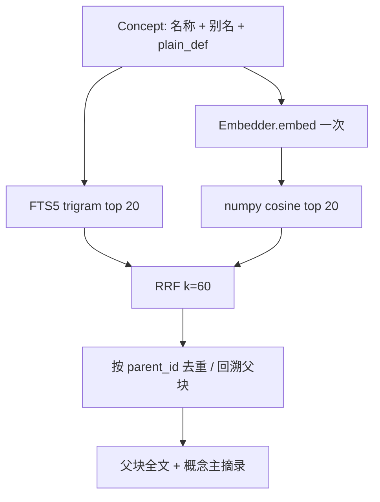

# 知识检索设计 v0.1

- 状态：DRAFT v0.1（2026-11-23）
- 父设计：`docs/designs/learning-companion-digital-human-v2.0.md`（FROZEN 2026-11-23）
- 依赖：`knowledge-ingestion-v0.1.md`（内容表、切块、`concept_sources` 的 schema 在那边定义；本文档只读）
- 关联：`agent-infrastructure-v0.1.md`（会话/评分边界）、`technical-plan-v0.1.md`（实现顺序）
- 范围：embedding、`chunk_embeddings`、`chunk_fts`、RRF、`Retriever`、`core.reindex`、召回验收。
- 不范围：材料解析、切块、抽概念、确认、题库、联网入口（归 `knowledge-ingestion-v0.1.md`）。
- 拆分说明：原 `knowledge-base-v0.1.md` 已拆成入库/检索两份；本文档决策 ID 用 `KR-01…KR-09`，映射见 §4。

## 1. 要解决的具体问题

### 1.1 表面问题

题目生成时，模型需要“这个概念在材料里的原文”。如果只靠关键词搜索，中文同义表达会漏；只靠向量，专有名词和标题词又会飘。v1 必须能稳定地从子块召回，再回溯父块给模型完整上下文。

### 1.2 三个具体问题

**① 中文召回**：材料是中文，FTS5 默认 tokenizer 对中文不友好；trigram 是否可用、召回是否够，必须实测。

**② 混合排序**：FTS 与向量各自有盲区。需要一条明确的融合规则（RRF），而不是“哪个分高用哪个”。

**③ 出处归属**：同一父块可能挂多个概念；检索结果必须能说清“这条结果属于哪个概念、摘录是哪一句”，否则题目出处会串。

### 1.3 明确不解决

- 不做 PDF 解析、切块、抽概念、题库（入库文档）。
- 不做每轮联网检索；联网只做材料入口。
- 不做 reranker、ANN、独立向量库（当前规模不需要）。
- 不改变 v2.0 的检索边界：只做本地 FTS5 + 向量混合。

## 2. 用户可感知的变化

- 每道生成题都能指到 `source_url` + `source_excerpt`；指不到就退回旧题。
- 检索失败或索引缺失时，会话不阻塞；当天仍能出题。
- 同一概念在不同材料/小节下的出处能区分，不会把 A 概念的摘录挂到 B 概念。
- 材料更新后，检索只用最新版本；旧版本块保留但不出现在结果里。

## 3. 影响范围

### 3.1 代码边界

| 模块 | 归属 | 说明 |
|---|---|---|
| `core/retrieval.py` | 本文档（v1） | FTS5 + numpy 向量 + RRF + 父块回溯 |
| `core/reindex.py` | 本文档（v1） | 重建 `chunk_fts`、补缺失 `chunk_embeddings` |
| `bff/providers/embeddings.py` | 本文档（v1） | OpenAI 兼容 `/embeddings` 适配器 |
| `bff/retrieval.py` | 本文档（v1） | 查询侧封装：拼 query、异步嵌入一次、调 `Retriever` |
| `core/embedding.py` | 本文档（v1） | 批量嵌入（10/批、重试一次、失败不写半批） |
| `core/store.py` 检索方法 | 本文档（v1） | `rebuild_fts`/`search_fts`/`upsert_embedding`/`embeddings_latest`/`concept_id_for_chunk` 等 |
| 材料解析、切块、抽概念、题库 | 入库文档 | 本文档不写这些表、不改内容 |

### 3.2 数据边界

- **只读**：`materials`、`material_chunks`、`concept_sources`、`concepts`（schema 见入库文档 §5.3）。
- **可写**：`chunk_embeddings`、`chunk_fts`（派生索引，可删可重建）。
- **不写**：`materials`/`material_chunks`/`concept_sources`/`concepts.yaml`/`seeds`，也不写 `sessions`/`session_questions`。
- **不新增**：独立向量库、Redis、消息队列。

### 3.3 对已冻结文档的影响

- v2.0 D3 已定“FTS5 + 向量 + RRF”，本文档只落参数与实现，不改方向。
- v2.0 的 embedding 模型是待定项；本文档 KR-01 落定为阿里 `text-embedding-v4` / 1024 维。
- `chunk_embeddings`、`chunk_fts` 是 v2.0 数据模型之外的加法派生表，按 `agent_sessions` 先例在 `FREEZE.md` 登记为加法变更。
- 入库文档拥有 `material_chunks` schema；本文档不重定义，只引用。

### 3.4 测试与验收边界

- 本文档必须落地：FTS trigram、向量 BLOB/cosine、RRF、父块回溯、概念归属、摘录选择、embedding 批量、20 条 Recall@5、降级。
- 不测：材料解析/切块/抽取/确认（入库文档）、会话流程/评分（agent 文档）。

### 3.5 运维边界

- 索引是派生数据：`data/app.db` 备份可以不含索引；重建用 `core.reindex`。
- 换 embedding 模型 = 换 `EMBEDDING_MODEL/DIM` + 全量 `core.reindex`；旧向量按 model/dim 过滤，不会混用。
- 索引重建不影响内容真相与已有分数。

## 4. 设计决策记录

规则沿用入库/agent 文档：只追加；ID 用 `KR-01…`；旧 `KB-xx` 映射见下表；状态 `accepted` / `superseded` / `revisit`。

| ID | 日期 | 决策 | 背景 | 备选 | 影响 | 状态 |
|---|---|---|---|---|---|---|
| KR-01 | 2026-11-23 | embedding 用阿里 DashScope `text-embedding-v4`，1024 维，OpenAI 兼容 `/embeddings`；配置 `EMBEDDING_BASE_URL/API_KEY/MODEL/DIM`；`Embedder` 端口可换供应商 | 本地模型依赖大/慢；项目已用云端 API；v4 同价且有 100 万 token 免费额度（90 天） | 本地 bge-small-zh / bge-m3 / OpenAI / SiliconFlow | 需要 DashScope key 与网络；离线不可用；超出额度后 0.5 元/百万 token | accepted（原 KB-08/KB-28） |
| KR-02 | 2026-11-23 | 向量存 `chunk_embeddings(chunk_id PK, model, dim, vector BLOB, created_at)`；float32、L2 归一化；numpy cosine；不用 sqlite-vec | 1-3 份材料、几千子块；暴力检索毫秒级；避免 pre-v1 扩展 | sqlite-vec / 只存内存 | 派生表可删可重建；>1 万块再评估 ANN | accepted（原 KB-29） |
| KR-03 | 2026-11-23 | FTS5 trigram 虚表 `chunk_fts`，索引 `heading_path + 换行 + 子块正文`；只查最新 `material_version` 且 `materials.status='active'`；query 按空白拆词、每词引号包裹、`OR` 连接 | SQLite 3.50.4 实测 trigram 可用、中文命中；标题词也要能召回 | 只索引正文 / 父子都索引 / LIKE | 虚表派生可重建；旧版本行保留但过滤 | accepted（原 KB-30） |
| KR-04 | 2026-11-23 | 检索 query = 概念名 + 别名 + `plain_def`；FTS 与向量共用同一段 query | 名称精确、别名覆盖同义、定义补语义 | 只名称 / 题目草稿 | 召回该概念出处概率最高；query embedding 只调一次 | accepted（原 KB-31） |
| KR-05 | 2026-11-23 | FTS 与向量各取 top 20，RRF `k=60` 等权融合，取 top 5 父块；同一父块多个子块命中取最高分去重 | 参数少、常见默认；先测召回再调 | top 10 / 手工权重 | 返回父块全文 + 子块摘录；`score` 是 RRF 分 | accepted（原 KB-32） |
| KR-06 | 2026-11-23 | 召回验收：20 条查询，Recall@5 ≥ 0.8；query 用名称+别名+定义；相关块为该概念主出处父块 | v2.0 只写“20 条门槛”没给数值 | Recall@10 / 不做门槛 | 0.8 占位，基线后校准；不达标调 RRF/切块 | accepted（原 KB-33） |
| KR-07 | 2026-11-23 | 索引由 `core.reindex` 显式构建：重建 `chunk_fts` + 补缺失 `chunk_embeddings`；入库只写内容表，不调 embedding/FTS；批量 10、单批重试一次、失败记录不写半批 | 入库与检索必须解耦；查询快、成本可预期 | 入库时嵌入 / 查询时懒嵌入 | ingest 后需多跑一步 `core.reindex`；失败可见可补 | accepted（supersedes 原 KB-34） |
| KR-08 | 2026-11-23 | 检索降级：FTS 不可用→只向量；embedding/向量不可用→只 FTS；两路都空/异常→返回 `[]`；调用方退回旧题 | 单一故障域不能阻塞会话 | 抛异常 / 阻塞等待 | 降级可见，不影响当天会话 | accepted（原 KB-35） |
| KR-09 | 2026-11-23 | 结果归属与摘录：`search` 接受 `concept_id`；同一父块多概念且无提示时 `concept_id` 返回 None；`source_excerpt` 优先取该概念 `concept_sources` 主摘录，否则取命中子块/父块中与 query 最相关的一句（不取 overlap 残句） | 同一父块可挂多个概念；overlap 会污染摘录 | 自动任选一个概念 / 整块子块当摘录 | 调用方必须传 `concept_id`；真实笔记验证通过 | accepted（原 KB-T35/T36） |

## 5. 派生存储

`material_chunks` / `concept_sources` 的字段定义见 `knowledge-ingestion-v0.1.md` §5.3；本文档只新增派生结构。

```sql
chunk_embeddings (
  chunk_id TEXT PRIMARY KEY,
  model TEXT NOT NULL,
  dim INTEGER NOT NULL,
  vector BLOB NOT NULL,               -- float32 little-endian，L2 归一化
  created_at TEXT NOT NULL
);

CREATE VIRTUAL TABLE IF NOT EXISTS chunk_fts USING fts5(
  chunk_id UNINDEXED,
  material_id UNINDEXED,
  material_version UNINDEXED,
  text,                                -- heading_path + 换行 + 子块正文
  tokenize='trigram'
);
```

约定：

- `chunk_fts` 只索引子块；父块不索引。
- 向量按 `model/dim` 存；换模型后旧行不匹配，不参与检索，需 `core.reindex` 重建。
- 检索只查最新版本：`material_chunks.material_version = materials.version` 且 `materials.status='active'`。
- 旧版本块与旧向量保留，用于历史出处；不进检索结果。
- 两张都是派生表，可 `DROP` 后由 `core.reindex` 重建；不影响内容真相与已有分数。

## 6. 最小检索管线

### 6.1 索引构建

```text
material_chunks（入库产物）
  → chunk_fts：子块 heading_path + 正文
  → chunk_embeddings：子块文本 → /embeddings → float32 BLOB
```

- `python -m core.reindex`：FTS 全量重建 + 缺失 embedding 补建。
- `python -m core.reindex --fts-only`：只重建 FTS。
- 批量 10 个 chunk/批；单批失败重试一次；仍失败记录，不写半批。

### 6.2 查询



硬约束：

- FTS query 按空白拆词，每词双引号包裹，用 `OR` 连接。
- RRF 只使用排名，不使用原始分；两路等权。
- 同一父块多个子块命中只返回一次，取最高 RRF 分。
- `source_excerpt`：优先 `concept_sources` 主摘录；没有则按 query 选句，避免 overlap 残句。
- 只查最新 `material_version` + `materials.status='active'`。
- FTS 失败只走向量，embedding 失败只走 FTS；两路都空返回 `[]`。

## 7. 接口

### 7.1 Retriever（同步）

```python
@dataclass(frozen=True, slots=True)
class RetrievedChunk:
    concept_id: str | None
    text: str             # 父块全文
    source_excerpt: str   # 概念主摘录或相关句
    source_url: str
    score: float

class Retriever(Protocol):
    def search(
        self,
        query: str,
        *,
        query_vector: Sequence[float] | None = None,
        concept_id: str | None = None,
        top_k: int = 5,
    ) -> list[RetrievedChunk]: ...
```

- `search` 同步；query 向量由 BFF 异步嵌入后传入，避免在异步上下文里跑 `asyncio.run`。
- `query_vector=None` 时只走 FTS；`concept_id` 由调用方传入，用于结果归属与摘录。
- 同一父块多概念且没传 `concept_id` 时，结果 `concept_id` 为 None。
- 无命中/索引不可用返回 `[]`，不抛异常。
- 结果写入 `session_questions.source_url/source_excerpt`，不能只留在内存。

### 7.2 Embedder（异步）

```python
class Embedder(Protocol):
    name: str
    model: str
    dim: int
    async def embed(self, texts: Sequence[str]) -> list[list[float]]: ...
```

- `bff/providers/embeddings.py` 实现 OpenAI 兼容 `/embeddings`；`core/` 只依赖端口。
- `bff/retrieval.py` 的 `retrieve_concept` 负责：拼 query → 嵌入一次 → 调 `Retriever.search`；embedding 失败退 FTS。

## 8. 验收与测试映射

| ID | 断言 | 阶段 | 现状 |
|---|---|---|---|
| KR-T01 | FTS5 trigram：中文 query 命中；按词 OR；旧 `material_version` 不进结果 | v1 | `tests/test_retrieval.py` |
| KR-T02 | 向量：BLOB float32 往返、L2 归一化、cosine top-k 顺序正确 | v1 | `tests/test_retrieval.py` |
| KR-T03 | RRF：合成两路排名融合顺序正确；同一父块多子块命中只返回一次 | v1 | `tests/test_retrieval.py` |
| KR-T04 | embedding 批量：10/批、单批重试一次、维度不符/失败不写半批；reindex 补缺失 | v1 | `tests/test_embedding.py` |
| KR-T05 | 查询侧：query 含名称/别名/定义；异步嵌入一次；embedding 失败退 FTS | v1 | `tests/test_query_retrieval.py` |
| KR-T06 | 摘录：按 query 选句，不带 overlap 残句；无匹配退父块 | v1 | `tests/test_retrieval.py` |
| KR-T07 | 概念出处指向父块时，子块命中能回溯到 `concept_id`；摘录优先主出处 | v1 | `tests/test_retrieval.py` |
| KR-T08 | 同一父块多概念：自动归属返回 None；传 `concept_id` 后归属与摘录正确 | v1 | `tests/test_retrieval.py` |
| KR-T09 | 20 条中文查询 Recall@5 ≥ 0.8（占位门槛） | v1 | 待真实材料 |
| KR-T10 | 检索降级：FTS/向量单路失败仍返回另一路；双空返回 `[]`，题目退回旧题 | v1 | `tests/test_retrieval.py` |

## 9. 开放问题与风险

1. **真实 API 未调**：阿里 `text-embedding-v4` 的 key、限流、`dimensions` 参数与批量上限待实测。
2. **20 条查询集**：需要首批 2-3 份真实材料与人工标注；当前材料只有 2 个父块，Recall 6/6 没有区分度。
3. **向量规模**：numpy 暴力当前够用；子块超过 1 万再评估 sqlite-vec/ANN。
4. **换模型成本**：换 embedding 模型/维度要全量 `core.reindex`；旧向量不参与，但占空间。
5. **embedding 失败语义**：`core.reindex` 单批重试一次；失败记录、不写半批；查询 embedding 失败只走 FTS。
6. **FTS 重建**：`core.reindex` 目前全量重建 `chunk_fts`；材料多后可改增量。
7. **摘录质量**：`best_excerpt` 仍是词面/二字组匹配；真实材料上要抽查，必要时用 concept_sources 主摘录兜底。

## 10. 与入库 / agent 文档的关系

- 优先级：v2.0 > 本文档 > 技术方案；任何改变 v2.0 硬约束的决定走 `FREEZE.md`。
- 本文档拥有：embedding、`chunk_embeddings`/`chunk_fts`、`Retriever`、`core.reindex`、召回验收。
- `knowledge-ingestion-v0.1.md` 拥有：材料、切块、概念抽取、`concepts.yaml`、题库、内容表 schema。
- agent 文档拥有：会话、五题配比、作答、评分、mastery、review_due、误解、`agent_sessions`。
- 读边界：本文档只读 `materials`/`material_chunks`/`concept_sources`/`concepts`；不写内容表。
- 写边界：入库不写 `chunk_embeddings`/`chunk_fts`；检索不写 `sessions`/`session_questions`/`agent_sessions`。
- 实现顺序仍按 `technical-plan-v0.1.md` §11-12；本 doc 不重排 v0/v1 任务。
