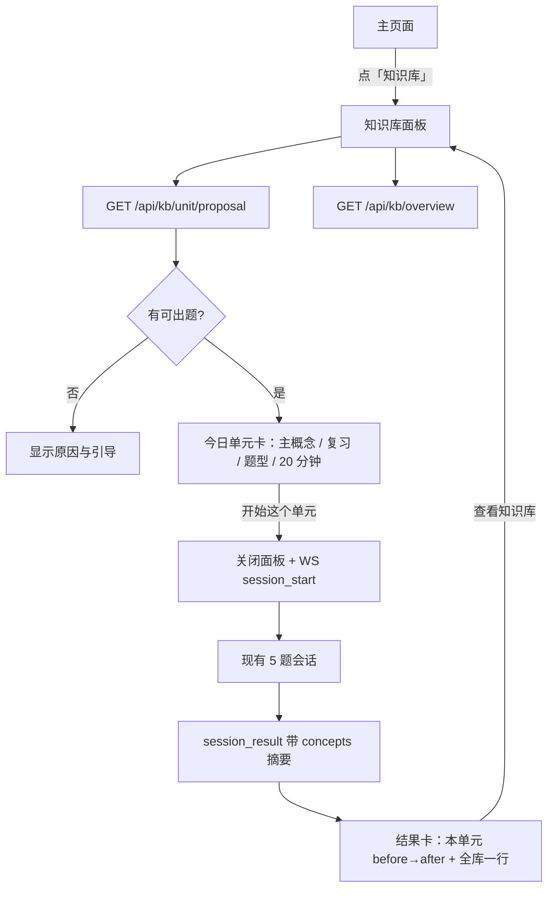

# 学习单元与掌握程度 v0.1

- 状态：DRAFT
- 日期：2026-11-25
- 依据：`learning-companion-digital-human-v2.0.md`（FROZEN）、`openspec/specs/coach-session/spec.md`、`openspec/specs/question-generation/spec.md`
- 范围：知识库面板里的「今日学习单元」提议、单元开始与结束、掌握程度展示
- 非范围：跨天单元、课程编排、材料/概念管理、管理后台、mastery 公式、出题/评分/语音链路

## 1. 结论摘要

1. **学习单元 = 现有的一场 5 题会话**。不新增单元表、不新增跨天状态机；`sessions` + `session_questions` 就是单元历史。
2. **提议是只读预览**。新增 `GET /api/kb/unit/proposal`，复用 Coach 的选题逻辑，不写库、不调模型、不生成题目。
3. **开始仍走现有 `session_start`**。知识库面板只负责展示提议和触发开始；会话、评分、结算、语音、3D 形象都不动。
4. **掌握程度 = 本单元前后对比 + 全库总览**。结算新增每概念 `mastery_before/after` 与本场概念得分；面板新增只读总览。
5. **临时宿主是主页面里的「知识库」面板**。面板与 `/api/kb/*` 自成一块，后续管理后台可以直接搬走。
6. **mastery 公式、5 题配比、复习规则全部沿用冻结版**。`partial`/`unscored`/review-only 不更新 mastery，这一条不改。

## 2. 现状（事实）

| 事实 | 位置 | 对本设计的影响 |
|---|---|---|
| 当前只有一个 Web 单页，没有知识库界面 | `web/index.html`、`web/app.js` | 需要新增一个临时知识库面板作为宿主 |
| `#start` 直接发送 `session_start`，没有提议确认 | `web/app.js` `startSession()` | 旧按钮保留为快捷开始；面板是带提议的单元入口 |
| 选题在 `Coach.start()` 内部完成：`Planner.next_concept` + 最逾期 1 个复习概念 | `core/coach.py`、`core/planner.py` | 提议必须复用同一套选题，不能另写一套 |
| 5 题配比由 `build_session_plan` 固定 | `core/question_generation.py` | 提议直接展示槽位的题型与角色 |
| mastery 只在 `status=completed` 且 `kind=daily` 时，按 `role=new` 的题均分更新 | `core/coach.py` `_mastery_updates` | `partial`/`unscored`/review-only 不更新，结果页要解释 |
| 结果卡只显示 `mastery` 的原始 map（concept id → 数字） | `web/app.js` `showResult()` | 需要改成概念名 + 标签 + 前后对比 |
| 已有 `concepts`、`sessions`、`session_questions`、`agent_sessions` | `core/db.py`、`core/store.py` | 不需要新增表；提议与总览都是读模型 |
| 只有 `/health`、`/ws`、静态资源，没有 JSON 读接口 | `bff/main.py` | 新增两个只读 HTTP 接口，不改 WS 主流程 |
| 评分/出题失败已有回退与未评分语义 | `core/coach.py`、`core/question_generation.py` | 单元摘要必须能表示「未评分」「提前结束」 |

## 3. 术语

| 术语 | 含义 | 避免 |
|---|---|---|
| 学习单元 | 一次打开的 5 题会话；当天可以重开多场 | 课程、章节、任务包 |
| 提议 | 开始前对「今天学什么」的只读预览，含主概念、复习概念、题型、理由 | 计划、排课 |
| 掌握程度 | 概念 `mastery` 0–5 的展示视图；不是新分数 | 掌握率、百分比 |
| 全库总览 | 在学概念的平均掌握度、0–5 分布、薄弱项、待复习与最近单元 | 统计报表 |
| 在学概念 | `concepts.status = active` 的概念 | 全部概念 |
| 薄弱 | `mastery <= 1` 且已经学过（`last_seen` 非空）的在学概念；用于提示，不是评分档位 | 待巩固 |
| 待复习 | `review_due_at <= today` 的在学概念 | 待巩固 |
| 待巩固 | 题目得分 60–79 的既有术语，**本设计不占用** | 与待复习混用 |

> 术语边界：`待巩固` 在 `GLOSSARY.md` 里已经定义为「某题得分 60 到 79」。本设计用 `待复习` 表示复习队列，不改变既有术语。

## 4. 用户流程



### 4.1 流程说明

1. 用户点主操作区的「知识库」按钮，面板从右侧滑出（移动端全屏）。
2. 面板并行请求提议与总览；两者都不调用模型、不写数据库。
3. 提议卡显示「今天主学什么、复习什么、为什么、5 题怎么分、约 20 分钟」。
4. 点「开始这个单元」：关闭面板，调用现有 `startSession()`；WS 协议不变。
5. 会话结束收到 `session_result`：结果卡显示本单元概念掌握度前后变化、本场得分、全库一行摘要。
6. 点结果卡「查看知识库」或主操作区「知识库」：面板刷新总览与最近单元。
7. 点「结束今天的学习」回到初始界面，当天可再次开始新单元。

### 4.2 面板状态

| 状态 | 面板表现 |
|---|---|
| 没有进行中的会话 | 显示提议卡与「开始这个单元」；总览与最近单元正常 |
| 会话进行中 | 提议卡显示「当前单元进行中」；开始按钮禁用；总览仍可看 |
| 结果卡展示中 | 提议卡显示「先结束本场」；开始按钮禁用，避免跳过「结束今天的学习」重置 |
| WS 未连接 | 开始按钮禁用，提示「还没连上服务」 |
| 提议不可用 | 显示原因与引导：补材料/确认概念，或先自由对话 |

## 5. 提议

### 5.1 计算规则

提议必须复用 `Coach.start()` 的选题逻辑，不能另写一套：

```text
today      = clock.today()
states     = store.concept_states()
main       = Planner.next_concept(states)          # active + 前置满足；难度低优先，同级最久没学
review     = 第一个到期复习概念                     # store.due_reviews(today)，按 due 日、id
plan       = build_session_plan(main, review)      # 固定 5 槽，题型与角色由程序决定
proposal   = 主概念 + 复习概念 + 槽位 + 理由
```

约束：

- 只读：不 `INSERT`/`UPDATE`，不生成题目，不调用 LLM/TTS/搜索。
- 确定性：同一份概念状态和同一天，连续调用结果一致；排序不依赖随机数。
- 提议只到「概念 + 题型」粒度；题目正文在 `session_start` 时才生成。
- 提案与开始之间的偏差：同一标签页、同一天内概念状态不变，`start` 重算结果一致。跨天或多标签页时以 `start` 的实际结果为准；v0 不引入 plan token（见 LU-08）。

### 5.2 返回形状

```json
{
  "available": true,
  "date": "2026-11-25",
  "kind": "daily",
  "estimate_minutes": 20,
  "question_count": 5,
  "deferred_reviews": 1,
  "main": {
    "id": "agent-loop",
    "name": "Agent Loop",
    "plain_def": "让智能体反复观察、行动、检查，直到任务完成。",
    "difficulty": 1,
    "mastery": 2,
    "mastery_label": "有印象",
    "last_seen": "2026-11-20",
    "last_score": 70,
    "prerequisites": [
      {"id": "llm-basic", "name": "大模型基础", "mastery": 3, "satisfied": true}
    ],
    "reason": "前置已满足；当前可解锁概念里难度最低，且已经 5 天没学"
  },
  "review": {
    "id": "tool-use",
    "name": "工具调用",
    "plain_def": "让模型按约定格式调用外部工具并读回结果。",
    "mastery": 1,
    "mastery_label": "初识",
    "review_due_at": "2026-11-24",
    "overdue_days": 1,
    "last_score": 60,
    "reason": "上次得分 60，低于 80，复习已到期 1 天"
  },
  "same_concept": false,
  "slots": [
    {"slot": 1, "type": "concept", "label": "概念理解", "role": "new", "concept_id": "agent-loop"},
    {"slot": 2, "type": "business", "label": "业务运用", "role": "new", "concept_id": "agent-loop"},
    {"slot": 3, "type": "tradeoff", "label": "取舍权衡", "role": "new", "concept_id": "agent-loop"},
    {"slot": 4, "type": "cost_risk", "label": "成本风险", "role": "review", "concept_id": "tool-use"},
    {"slot": 5, "type": "synthesis", "label": "综合判断", "role": "review", "concept_id": "tool-use"}
  ]
}
```

字段说明：

| 字段 | 说明 |
|---|---|
| `available` | 没有可出题时为 `false`，其余字段可缺省 |
| `kind` | `daily`（有主概念）或 `review`（只有复习） |
| `deferred_reviews` | 到期复习总数减 1（若已选 1 个）；0 表示没有顺延 |
| `main` / `review` | 概念卡片；没有则为 `null` |
| `mastery` / `mastery_label` | 当前掌握度与展示标签；标签只用于展示 |
| `last_score` | 该概念最近一次 completed daily 的新题均分；没有则 `null` |
| `prerequisites` | 主概念的前置及是否满足；复习概念为 `[]` |
| `slots` | 5 个槽位的题型、角色与概念归属；与 `build_session_plan` 一致 |

### 5.3 理由文案

理由由程序按事实拼，不调用模型：

| 场景 | 文案要点 |
|---|---|
| 主概念从未学过 | 「从未学过」 |
| 主概念学过 | 「上次学过 YYYY-MM-DD，已 N 天没学」 |
| 主概念难度 | 「当前可解锁概念里难度最低（难度 N）」 |
| 前置满足 | 「前置 X 已到 mastery 3」或「前置 X 已跳过」 |
| 复习到期 | 「复习已到期 N 天」；`N=0` 时写「今天到期」 |
| 复习低分 | 「上次得分 60，低于 80」；没有分数时省略 |
| 同一概念 | `same_concept=true`，文案写「主概念也是复习概念：3 道新题 + 2 道复习题」 |

### 5.4 不可用

```json
{
  "available": false,
  "date": "2026-11-25",
  "reason": "没有可出的新概念，也没有到期复习"
}
```

其他不可用原因：

- 「所有在学概念都被前置锁住」：Planner 找不到可解锁的新概念。
- 「没有在学概念」：概念表为空或全部是 proposed/skipped/known。
- 「今天没有到期复习」不是不可用原因；只要还有新概念就可出 daily。

面板对不可用状态给两条引导：补材料/确认概念，或先用自由对话。开始按钮禁用。

## 6. 单元开始

### 6.1 从面板开始

面板「开始这个单元」只做三件事：

1. 关闭面板。
2. 调用现有 `startSession()`。
3. 由 `startSession()` 发送 `{"type": "session_start", "kind": "daily"}`。

WS 消息形状不变。`Coach.start()` 仍然自己选题、生成、落库；提议不会把概念 id 传回去，避免出现「提议一套、开始另一套」的隐式契约。

### 6.2 会话内显示提议结果

为了让用户进入会话后仍知道「今天在学什么」，`session_ready` 增加一个只读字段：

```json
{
  "type": "session_ready",
  "session_id": "...",
  "kind": "daily",
  "unit": {
    "kind": "daily",
    "main": {"id": "agent-loop", "name": "Agent Loop"},
    "review": {"id": "tool-use", "name": "工具调用"}
  },
  "question": { "...": "..." }
}
```

- `unit` 由 BFF 从 `session_questions` 推导：`role=new` 的概念为主概念，`role=review` 的概念为复习概念；名字来自 `concepts.yaml`。
- `session_resume` 返回的 `session_ready` 也带同样的 `unit`，断线重连不丢「今天学什么」。
- 会话面板顶部显示一行「今日单元：Agent Loop（复习：工具调用）」；review-only 显示「今日单元：复习工具调用」。
- 这是加法字段，旧客户端忽略即可。

### 6.3 旧入口

主操作区原有的「开始今天的学习」按钮保留为快捷开始：不展示提议，直接 `session_start`。带提议的单元入口是「知识库」面板。两者最终都进入同一个 `Coach.start()`。

**为什么不把旧按钮改成打开面板**：会改变现有浏览器验收脚本的点击路径（`tests/browser/check_question_ui.mjs` 点 `#start` 后等 `session_start`），也会给熟练用户多一次点击。等管理后台落地后再统一入口。

## 7. 结算与掌握程度

### 7.1 沿用的冻结规则（不改）

| 规则 | 现状 |
|---|---|
| 单元分数 | 已评分题得分的算术平均；未评分题不按 0 分计 |
| completed | 所有题都已作答且都评分 |
| partial | 至少 1 题评分，但没答完或有题未评分 |
| unscored | 一题都没评上，不写分数 |
| mastery 更新 | 仅 `completed` + `kind=daily`；按该概念 `role=new` 已评分题均分 |
| mastery 公式 | 最近三次 completed daily 的 `concept_session_score` 均值 / 20，四舍五入 |
| 复习到期 | 复习题均分 < 80 → 次日；>= 80 → 清空 `review_due_at` 与 `review_started_at` |
| 同场同概念 | 3 道新题 + 2 道复习题；复习结果优先决定 due，新题均分决定 mastery |
| review-only | 只更新复习到期，不更新 mastery |
| partial 的复习排期 | 已评分题照常参与 due 计算；mastery 不更新。未评分题不影响 due |

### 7.2 本单元摘要（新增）

`Settlement` 增加 `concepts` 元组，`session_result` 增加同名数组：

```json
{
  "type": "session_result",
  "session_id": "...",
  "status": "completed",
  "session_score": 72.0,
  "mastery": {"agent-loop": 3},
  "review_due_at": "2026-11-26",
  "concepts": [
    {
      "id": "agent-loop",
      "name": "Agent Loop",
      "roles": ["new"],
      "new_score": 66.7,
      "review_score": null,
      "mastery_before": 2,
      "mastery_before_label": "有印象",
      "mastery_after": 3,
      "mastery_after_label": "基本掌握",
      "mastery_updated": true,
      "review_due_at": "2026-11-26"
    },
    {
      "id": "tool-use",
      "name": "工具调用",
      "roles": ["review"],
      "new_score": null,
      "review_score": 85.0,
      "mastery_before": 1,
      "mastery_before_label": "初识",
      "mastery_after": 1,
      "mastery_after_label": "初识",
      "mastery_updated": false,
      "review_due_at": null
    }
  ],
  "scores": [ "...保持原样..." ]
}
```

字段规则：

| 字段 | 规则 |
|---|---|
| `roles` | 该概念在本场出现的角色；同概念两角色时为 `["new","review"]` |
| `new_score` | 该概念 `role=new` 已评分题均分；没有则 `null` |
| `review_score` | 该概念 `role=review` 已评分题均分；没有则 `null` |
| `mastery_before` | 结算前读到的 mastery；捕获时机见 §9.3 |
| `mastery_before_label` | before 的展示标签 |
| `mastery_after` | 结算后的 mastery；没更新时等于 before |
| `mastery_after_label` | after 的展示标签 |
| `mastery_updated` | 该概念本场是否写入 mastery；只有 completed daily 的 new 角色可能为 true |
| `review_due_at` | 结算后的复习到期日；`null` 表示无排期 |

兼容：

- `mastery` 保留原 map（只含更新过的概念），旧客户端不受影响。
- `review_due_at` 保留原字段（主概念的到期日），新客户端优先用 `concepts[].review_due_at`。
- `scores` 保持原样，逐题得分与出处不变。

### 7.3 结果卡文案

| 场景 | 文案 |
|---|---|
| completed daily，有更新 | 「Agent Loop：掌握度 2 → 3（基本掌握）；本场新题均分 66.7」 |
| completed daily，没更新（如复习达标） | 「工具调用：掌握度 1（本场未更新）；复习均分 85」 |
| partial | 「本单元未完成，掌握度未更新」；仍显示已答概念的得分；已评分题可能已更新复习排期 |
| unscored | 「本场没有评上分，掌握度未更新」 |
| review-only | 「复习：工具调用，均分 85；复习达标，不再排期」或「均分 60；明日再复习」 |
| 同概念 | 「Agent Loop：3 道新题均分 66.7，2 道复习均分 85；掌握度 2 → 3」 |

「未完成，掌握度未更新」必须在 partial/unscored 时显式出现，避免用户以为分数没生效是 bug。

### 7.4 全库总览

`GET /api/kb/overview` 返回：

```json
{
  "date": "2026-11-25",
  "stats": {
    "active": 12,
    "known": 2,
    "skipped": 1,
    "proposed": 0,
    "orphaned": 0,
    "avg_mastery": 2.4,
    "distribution": [
      {"mastery": 0, "label": "未掌握", "count": 2},
      {"mastery": 1, "label": "初识", "count": 1},
      {"mastery": 2, "label": "有印象", "count": 3},
      {"mastery": 3, "label": "基本掌握", "count": 3},
      {"mastery": 4, "label": "熟练", "count": 2},
      {"mastery": 5, "label": "精通", "count": 1}
    ],
    "due": 2,
    "overdue": 1,
    "weak": 3
  },
  "concepts": [
    {
      "id": "tool-use",
      "name": "工具调用",
      "plain_def": "让模型按约定格式调用外部工具并读回结果。",
      "mastery": 1,
      "mastery_label": "初识",
      "status": "active",
      "last_seen": "2026-11-20",
      "review_due_at": "2026-11-24",
      "overdue_days": 1
    }
  ],
  "recent_units": [
    {
      "session_id": "...",
      "date": "2026-11-24",
      "kind": "daily",
      "status": "completed",
      "session_score": 78.0,
      "concept_names": ["Agent Loop", "工具调用"]
    }
  ]
}
```

统计口径：

| 字段 | 口径 |
|---|---|
| `active`/`known`/`skipped`/`proposed`/`orphaned` | 按 `concepts.status` 计数 |
| `avg_mastery` | 只算 `active`；一位小数；没有 active 时为 `null` |
| `distribution` | 只算 `active` 的 0–5 分布 |
| `due` | `active` 且 `review_due_at <= today` |
| `overdue` | `due` 中 `review_due_at < today` |
| `weak` | `active` 且 `last_seen` 非空且 `mastery <= 1` |
| `concepts` | 只列 `active`，按 `mastery` 升序、`review_due_at`、`name` 排序 |
| `recent_units` | 最近 5 场 `sessions`，含涉及概念名；review-only 也列 |

### 7.5 掌握度标签

| mastery | 标签 | 说明 |
|---|---|---|
| 0 | 未掌握 | 还没有形成有效掌握（未学或得分很低） |
| 1 | 初识 | 刚接触，能认出名词 |
| 2 | 有印象 | 能说个大概，但不稳定 |
| 3 | 基本掌握 | 达到前置解锁门槛 |
| 4 | 熟练 | 多次稳定在较高分 |
| 5 | 精通 | 最近三次稳定接近满分 |

标签只用于展示，**不参与 mastery 计算**，改文案不需要迁移数据。平均掌握度显示成 `2.4 / 5`，不换算百分比，避免「2.4/5 = 48%」造成误解。

## 8. 界面

### 8.1 入口与面板

- 主操作区 `#actions` 增加「知识库」按钮，位于「开始今天的学习」左侧。
- 面板是覆盖层 `#kbpanel`，桌面右侧 420px 抽屉，移动端全屏 sheet；沿用暖色书房 + 奶油玻璃卡片风格。
- 面板不加载 3D 形象、不播放音频、不采集麦克风；它只读 HTTP 数据和触发开始。
- 关闭：右上角按钮、点击遮罩、Esc。
- 打开时并行请求 `proposal` 与 `overview`；显示骨架/加载文案，失败给「重试」。

### 8.2 今日单元卡

| 行 | 内容 |
|---|---|
| 标题 | 「今天学什么」+ 日期 |
| 主概念 | 名称、难度、当前掌握度、一句理由 |
| 复习概念 | 名称、到期/逾期、上次得分、一句理由 |
| 题型 | 5 个标签：概念理解 / 业务运用 / 取舍权衡 / 成本风险 / 综合判断；标出新题/复习 |
| 时间 | 「约 20 分钟 · 5 题」 |
| 顺延 | 有多个到期复习时显示「另有 N 个复习顺延」 |
| 操作 | 「开始这个单元」；不可用时禁用并显示原因 |

提议不可用时，卡片显示原因 + 两条引导：「补充材料或确认新概念」「先自由对话」。

### 8.3 掌握程度区

- 顶部一行：`在学 12 个 · 平均 2.4 / 5 · 待复习 2 · 薄弱 3`。
- 0–5 分布：6 个短条/点，标数量；不画复杂图表。
- 概念列表：每行概念名、掌握度点（0–5）、标签、下次复习/逾期天数、上次学习日期。
- 排序：薄弱优先（mastery 升序），再按复习到期、名称。
- `known`/`skipped`/`proposed` 只显示数量，不展开列表（v0 范围）。
- 空状态：没有在学概念时显示「还没有在学概念，先去确认概念或补材料」。

### 8.4 最近单元

- 最近 5 场：日期、`daily/review`、`completed/partial/unscored`、得分、涉及概念名。
- 状态文案：完成 / 提前结束 / 未评分。
- 不做详情跳转；逐题明细仍在结果卡和数据库里，后续管理后台再加。

### 8.5 结果卡改造

现有 `showResult()` 的逐题列表保留，替换/增加以下内容：

1. **去掉**原始 `mastery` map（`agent-loop mastery 3`）。
2. **增加**：
   - 「本单元」概念行：名称 + before→after + 本场得分 + 是否更新。
   - 全库一行：`在学 12 个 · 平均 2.4 / 5 · 待复习 2`（`session_result` 后异步取 overview；失败则显示「全库总览暂时不可用」）。
   - 「查看知识库」按钮：打开面板并刷新。
3. 状态为 partial/unscored 时，显著显示「掌握度未更新」及原因（提前结束/有题未评分/全部未评分）。

### 8.6 状态与错误

| 情况 | 表现 |
|---|---|
| 面板加载中 | 「正在读取知识库…」 |
| 提议/总览失败 | 对应区块显示错误与「重试」；互不阻塞 |
| 没有可出题 | 提议卡显示原因；开始禁用 |
| 会话进行中 | 开始禁用，文案「当前单元进行中」 |
| 结果卡展示中 | 开始禁用，文案「先结束本场」 |
| 概念名缺失 | 回退显示 concept id |
| 没有任何会话 | 「最近单元」显示「还没有完成过单元」 |

### 8.7 明确不做

- 不做材料列表、概念确认、编辑/删除、题库管理；这些属于管理后台。
- 不做单元详情页、跨天单元进度、日历/课程表。
- 不做「换一个提议」；v0 只有当前提议。
- 不改语音、3D 形象、VAD、TTS。
- 不改 `session_start` 的必填字段；只给 `session_ready`/`session_result` 加字段。

## 9. 接口与代码落点

### 9.1 HTTP 只读接口

| 方法 | 路径 | 用途 |
|---|---|---|
| GET | `/api/kb/unit/proposal` | 今日单元提议 |
| GET | `/api/kb/overview` | 全库掌握程度总览 + 最近单元 |

约定：

- 同源、无鉴权（本地应用）；后续管理后台再加鉴权。
- 只读；不写库、不调 provider、不生成题目。
- 200 返回 JSON；不可用也是 200 + `available=false`；数据库/内部错误返回 500 + `{"error": "..."}`。
- 注册在静态资源挂载之前，避免被 `/` 的 `StaticFiles` 吞掉。

### 9.2 WS 加法字段

| 事件 | 新增字段 | 说明 |
|---|---|---|
| `session_ready` | `unit` | `{kind, main: {id,name}|null, review: {id,name}|null}`；start 与 resume 都带 |
| `session_result` | `concepts` | 本单元概念摘要；见 §7.2 |

其余 WS 消息、字段、事件顺序不变。旧客户端忽略新字段即可。

### 9.3 Core

| 文件 | 改动 |
|---|---|
| `core/models.py` | 增加 `MASTERY_LABELS`、`ProposalConcept`、`ProposalSlot`、`UnitProposal`、`ConceptUnitResult` 数据类 |
| `core/coach.py` | 抽出只读 `propose()`；`start()` 复用同一选题；`finish()` 捕获 before、生成 `concepts` 摘要 |
| `core/progress.py` | 新增 `build_overview()`、`ConceptProgress`/`ProgressStats`/`UnitHistoryItem`/`ProgressOverview`；标签从 `core/models.py` 引用 |
| `core/store.py` | 增加 `recent_units(limit=5)`；不改表结构 |
| `core/planner.py` | 不改；提议直接调用 `next_concept` 与 `due_reviews` |
| `core/question_generation.py` | 不改；提议复用 `build_session_plan` 的槽位 |

**before 捕获时机**：`Coach.finish()` 在调用 `store.finalize()` 之前，读取本场涉及概念的 `concept_state().mastery`；`finalize()` 之后再读一次得到 after 与 `review_due_at`。这样不需要新表，也能在 partial/unscored 时给出「未更新」的前后值。

**概念得分**：`finish()` 从本次 `session_questions` 中按 `concept_id` + `question_role` 聚合已评分题；`role=new` 的均值只用于展示，mastery 仍走既有 `_mastery_updates`，不重复计算。

### 9.4 BFF

| 文件 | 改动 |
|---|---|
| `bff/knowledge.py` | 新增 `APIRouter`，实现两个 GET；用 `request.app.state` 的 `store`/`concepts`/`clock` |
| `bff/main.py` | `create_app()` 注册 router；`_send_session_ready` 与 `session_resume` 增加 `unit`；`_result_event` 序列化 `concepts` |

`unit` 的推导：读 `session_questions(session_id)`，`role=new` 的概念为主概念，`role=review` 的概念为复习概念；概念名从 `app.state.concepts` 取。start 与 resume 共用一个 helper，避免两套逻辑。

### 9.5 前端

| 文件 | 改动 |
|---|---|
| `web/index.html` | `#actions` 加「知识库」按钮；新增 `#kbpanel` 覆盖层与 `#unitlabel` 会话顶部行 |
| `web/kb.js` | 新增：面板打开/关闭、并行请求、提议卡/总览/最近单元渲染、开始回调、错误与空状态 |
| `web/app.js` | import `kb.js`；接线「知识库」按钮与「开始这个单元」→ `startSession()`；`showResult()` 用 `result.concepts`；`session_ready` 显示 `unit`；结果卡「查看知识库」 |
| `web/style.css` | 面板、分布条、掌握度点、概念列表、移动端 sheet |

`web/index.html` 里的 `?v=` 缓存串按现有惯例同步更新（`app.js`、`style.css`、新增 `kb.js`）。

`web/kb.js` 不直接操作会话状态；它只接收两个回调：

- `canStartUnit()` → `boolean`
- `onStartUnit()` → 关闭面板并调用 `startSession()`

这样后续搬到管理后台时，只需替换入口与回调，不用把面板逻辑从 `app.js` 里拆出来。

### 9.6 数据

- **不新增表、不加列、不迁移 schema**。当前 `SCHEMA_VERSION=6` 保持不变。
- 单元历史 = `sessions` + `session_questions`；mastery = `concepts`。
- 提议、总览都是读模型，不持久化；提议不写 `agent_sessions`。
- 结果摘要不落库；需要回放时从 `sessions` + `session_questions` 重算（`mastery_before` 从该场之前的历史 completed daily 分数推导）。这样避免为展示字段引入冗余列。
- 断线错过 `session_result` 时，结果卡的前后对比不会补发；知识库面板的总览与最近单元仍能看到最新 mastery 与本场分数。

## 10. 边界与失败

| 场景 | 行为 |
|---|---|
| 没有在学概念 / 全部被前置锁住 | 提议 `available=false`；开始禁用；面板引导补材料/确认概念 |
| 只有到期复习、没有新概念 | 提议 `kind=review`，5 题全复习；结算不更新 mastery，结果卡说明 |
| 主概念与复习概念相同 | 5 题同概念，3 新 + 2 复习；`same_concept=true`；mastery 用新题，due 用复习题 |
| 出题生成失败 | 沿用旧题库回退；提议仍有效（概念级）；结果照常 |
| partial | 记录单元；不更新 mastery；已评分题可能更新复习排期；结果卡显示「未完成，掌握度未更新」 |
| unscored | 记录单元；无分数；结果卡显示「本场没有评上分」 |
| 会话进行中打开面板 | 开始禁用；不打断当前会话 |
| 跨天/多标签页 | 提议是预览，`start` 重算；结果以实际会话为准；v0 不做 plan token |
| 数据库错误 | HTTP 500；面板该区块显示错误与重试；不影响已有会话 |
| provider 全部离线（fake） | 提议/总览正常（不调 provider）；开始后走假出题/评分，结果摘要正常 |
| 概念名缺失 | 回退 concept id；不抛错 |
| 复习概念没有历史分数 | 提议省略「上次得分」，只写到期天数 |
| 结果卡展示中打开面板 | 开始禁用，提示先结束本场 |

## 11. 迁移到管理后台

面板按「可搬走」设计：

1. **数据边界**：`/api/kb/unit/proposal` 与 `/api/kb/overview` 是稳定读接口；管理后台可直接复用。
2. **视图边界**：`web/kb.js` + `#kbpanel` 标记 + `style.css` 里的 `.kb-*` 类；不依赖 3D/音频/WS 内部状态。
3. **动作边界**：开始单元只通过 `onStartUnit()` 回调；管理后台可以把它换成自己的「开始学习」路由或保留当前会话页。
4. **迁移时后加**：材料/概念管理、鉴权、单元详情、题库审计；这些不改变本设计的读模型。

当前的临时性只体现在入口位置：入口从主页面「知识库」按钮移到管理后台导航。API、渲染、数据口径不变。

## 12. 测试与验收

### 12.1 测试映射

| 验收项 | 测试 |
|---|---|
| 提议选题与 `Coach.start` 一致、无写库、理由字段、同概念、review-only、不可用 | 新增 `tests/test_proposal.py` |
| 总览统计、标签、分布、排序、最近单元、空状态 | 新增 `tests/test_progress.py` |
| 结算 before/after、partial/unscored 不更新、review-only、同概念、未评分 | 扩展 `tests/test_settlement.py` |
| 两个 GET 的 JSON、200/500、静态路由不吞接口 | 新增 `tests/test_kb_api.py` |
| `session_ready.unit`、`session_result.concepts` 形状 | 扩展 `tests/test_ws.py` |
| 完整 5 题流程仍通过 | 现有 `tests/test_coach_flow.py`、`test_web_acceptance.py` |
| 面板渲染、开始按钮、结果卡、移动端 | 新增 `tests/browser/check_kb_panel.mjs`（本地 Playwright，真实 fake 后端） |

### 12.2 验收标准

- **LU-A1**：打开面板只发两个 GET，不调 LLM/TTS/搜索，不写库。
- **LU-A2**：同一状态/日期下，提议的 `main`/`review`/`slots` 与 `Coach.start` 实际结果一致。
- **LU-A3**：从面板开始后，`session_ready.unit` 与提议中的概念一致；断线重连的 `session_resume` 也带 `unit`。
- **LU-A4**：completed daily 的结果卡显示每个概念的 before→after 与本场得分；`mastery_updated=true`。
- **LU-A5**：partial/unscored/review-only 不改变 mastery；结果卡显式写「未更新」及原因。
- **LU-A6**：总览的 active/avg/distribution/due/weak 与数据库一致；空状态不报错。
- **LU-A7**：没有 schema 迁移；现有测试全绿；新增测试全绿。
- **LU-A8**：`web/kb.js` 不依赖 3D/音频；移除面板不影响会话主流程。
- **LU-A9**：结果卡不再出现原始 concept id；显示名称与标签。
- **LU-A10**：桌面与移动端面板可用；Esc/遮罩可关；无 console error。

### 12.3 手工验收（真实 provider 可选）

1. 启动 fake 模式，打开页面（先确保有至少 1 个 active 概念和 1 个到期复习）。
2. 点「知识库」：确认提议的主概念、复习概念、理由、5 个题型、20 分钟。
3. 点「开始这个单元」：确认会话顶部出现「今日单元」；答完 5 题。
4. 看结果卡：确认 before→after、本场得分、「掌握度未更新」条件正确、全库一行。
5. 点「查看知识库」：确认总览与最近单元已更新。
6. 刷新页面再打开面板：确认数据来自数据库，不依赖内存。
7. 点「提前结束」：确认 partial 不更新 mastery，面板显示「提前结束」。

## 13. 实施顺序

| 步骤 | 内容 | 验证 |
|---|---|---|
| 1 | `core/models.py`（含 `MASTERY_LABELS`）+ `core/coach.py` 的 `propose()` | `tests/test_proposal.py`：选题、理由、无写库 |
| 2 | `core/progress.py` + `Store.recent_units()` | `tests/test_progress.py`：统计、排序、空状态 |
| 3 | `Coach.finish()` 的 `concepts` 摘要 + before 捕获 | `tests/test_settlement.py`：completed/partial/unscored/review-only/同概念 |
| 4 | `bff/knowledge.py` 两个 GET + 注册路由 | `tests/test_kb_api.py`：JSON、路由顺序、错误 |
| 5 | `session_ready.unit` + `session_result.concepts` | `tests/test_ws.py`：字段形状；现有 WS 测试不回归 |
| 6 | `web/kb.js` + 面板 + 结果卡 + 样式 | `tests/browser/check_kb_panel.mjs`：桌面/移动、开始、结果、空状态 |
| 7 | 实现回写（哈希/状态）+ 全量测试 | `python -m pytest -q` 全绿；浏览器 smoke |

每一步都可独立回滚；步骤 1–3 不碰前端，步骤 4–5 不碰样式，步骤 6 才动 UI。

## 14. 决策与假设

| ID | 日期 | 决策/假设 | 依据 | 状态 |
|---|---|---|---|---|
| LU-01 | 2026-11-25 | 学习单元 = 一场 5 题会话 | 用户选择；复用现有 Coach，改动最小 | accepted |
| LU-02 | 2026-11-25 | 临时宿主 = 主页面「知识库」面板 | 用户选择；后续整块搬管理后台 | accepted |
| LU-03 | 2026-11-25 | 掌握程度 = 单元前后 + 全库总览 | 用户选择；结果卡与面板各承担一半 | accepted |
| LU-04 | 2026-11-25 | 不新增单元表/状态机；单元历史用 `sessions` | 避免为展示引入跨天状态 | accepted |
| LU-05 | 2026-11-25 | 提议只读、不生成题目、不调模型 | 提议要快且可重复；题目生成留给 start | accepted |
| LU-06 | 2026-11-25 | mastery 公式、5 题配比、复习规则不变 | v2.0 FROZEN 与 coach-session spec | accepted |
| LU-07 | 2026-11-25 | partial/unscored/review-only 不更新 mastery | 冻结版 P5 与结算规则 | accepted |
| LU-08 | 2026-11-25 | 提议不做 plan token；start 重算 | 同一标签页/同一天状态不变；多标签页以实际为准 | assumption |
| LU-09 | 2026-11-25 | 旧「开始今天的学习」保留为快捷开始 | 不改现有浏览器验收路径；面板是带提议的入口 | assumption |
| LU-10 | 2026-11-25 | v0 不做「换一个提议」 | 避免引入排除/重排规则；后续可加 | assumption |
| LU-11 | 2026-11-25 | 总览只列 active 概念；known/skipped/proposed 只给计数 | 面板聚焦在学内容，避免临时界面膨胀 | assumption |
| LU-12 | 2026-11-25 | 结果摘要不落库，按需从 `sessions` + `session_questions` 重算 | 避免冗余列；before 从该场之前的历史 completed daily 分数推导 | assumption |
| LU-13 | 2026-11-25 | 标签只用于展示，不参与 mastery | 标签可调文案，不改数据 | assumption |

## 15. 开放问题

1. **known/skipped 是否要展开列表？** 当前只给计数；如果用户想把「已掌握」也当档案看，再在管理后台加。
2. **提议是否允许换一个/跳过？** v0 不做；若做，需要给 Planner 加排除集合并定义「换几次」。
3. **主按钮是否改为先开面板？** v0 保留快捷开始；管理后台落地时统一入口。
4. **单元历史是否需要详情？** 当前只有日期/状态/分数/概念名；逐题明细在 `session_questions`，后续管理后台加。
5. **mastery 标签文案是否要更学术？** 当前是中性六级；可以只改文案。
6. **多标签页/跨天的一致性**：是否需要 plan token 或「提议已过期」提示？v0 以 start 实际结果为准。
7. **管理后台鉴权**：搬到后台时再加；当前本地无鉴权。

## 16. 变更记录

| 日期 | 版本 | 摘要 |
|---|---|---|
| 2026-11-25 | v0.1 DRAFT | 新建：学习单元 = 一场 5 题会话；知识库面板承载提议/掌握程度/最近单元；只读提议与总览 API；结算新增概念 before/after；不改 schema/公式/语音 |
