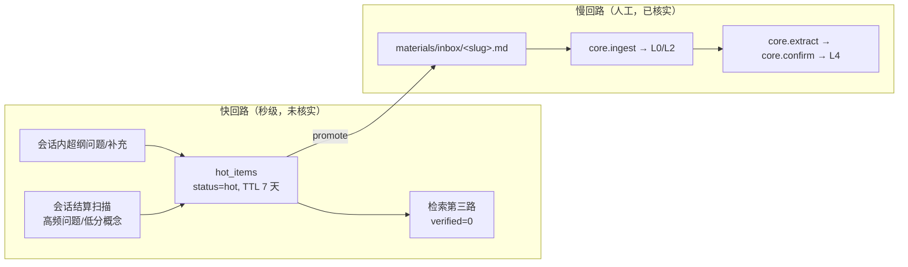

# 实时知识热注入设计 v0.1

- 状态：DRAFT v0.1（2026-11-23）
- 父设计：`docs/designs/learning-companion-digital-human-v2.0.md`（FROZEN 2026-11-23）
- 依赖：`knowledge-ingestion-v0.1.md`（L0/L2 与晋升后的管线）、`knowledge-retrieval-v0.1.md`（L3）、`agent-infrastructure-v0.1.md`（会话与 `session_questions`）、`storage-layers-v0.1.md`（L4 归属）
- 范围：会话内超纲知识点、agent 高频问题/误解的即时捕获、检索与人工晋升。
- 不范围：外部网页抓取、agent 联网搜索、自动写入主库、题库生成。
- 自由对话的联网兜底不在本文档范围，见 OpenSpec change `free-talk-web-search`；其结果不进入 hot 项。

## 1. 要解决的具体问题

会话里会出现两类知识库没有覆盖的内容：

1. **会话内超纲知识点**：你问到材料之外的概念，或主动补充了一个材料里没有的说法。
2. **agent 高频问题/误解**：同一个问题反复出现、同一概念连续低分，说明知识库缺内容或概念定义有偏差。

当前没有任何承接方式：要么当场答完就丢，要么靠人记下来再手工补材料。两种都会让同样的缺口反复出现。

## 2. 目标与非目标

目标：

- 会话内即时捕获，当天就能参与检索，不让"材料外"变成"答不了"。
- 捕获内容带来源与时间，可审计、可过期。
- 与主知识库严格隔离：未核实内容不冒充已核实出处。

非目标（MUST NOT）：

- 不自动联网、不抓取外部网页（保持 v2.0「联网只做材料入口」边界）。
- 不把未核实内容写进 `concept_sources`，不作为计分题出处。
- 不捕获 agent 自己生成的文本（防止幻觉入库）。
- 不做实时流式管道（Kafka/CDC）；单人本地应用用微批与事件触发足够。

## 3. 双层模型



- 快回路只服务"当天能答"，不改变主知识库。
- 慢回路是唯一入库路径：人工确认 → 落成材料 → 正常摄取 → 正常确认。

## 4. 存储与归属

归 L4（溯源与策略）的未核实缓冲区；`hot_fts` 是它的派生索引，可重建。

```sql
CREATE TABLE IF NOT EXISTS hot_items (
  id INTEGER PRIMARY KEY AUTOINCREMENT,
  source_kind TEXT NOT NULL CHECK (source_kind IN ('session','agent')),
  source_url TEXT,
  title TEXT,
  text TEXT NOT NULL,
  content_hash TEXT NOT NULL UNIQUE,
  captured_at TEXT NOT NULL,
  last_seen TEXT NOT NULL,
  seen_count INTEGER NOT NULL DEFAULT 1,
  expires_at TEXT,
  status TEXT NOT NULL CHECK (status IN ('hot','promoted','discarded','expired')),
  material_id TEXT
);

CREATE VIRTUAL TABLE IF NOT EXISTS hot_fts USING fts5(
  hot_id UNINDEXED,
  title,
  text,
  tokenize='trigram'
);
```

约定：

- `content_hash` = 规范化文本 SHA-256，做捕获去重；重复捕获只更新 `last_seen`/`seen_count`。
- `source_kind='session'`：会话内超纲；`'agent'`：结算扫描出的高频问题/低分概念。
- `title` 可为空；检索时与正文一起索引。
- `material_id` 只在晋升后回填，指向 L0 的材料 id。
- 不存向量：hot 条目数量少（目标 <500），查询是用户原话，FTS trigram 足够；召回不足再评估向量（RT-05）。

不变量：

- IN-HOT-1：`hot_items` 永不写 `concept_sources`，永不作为计分题的 `source_url`/`source_excerpt`。
- IN-HOT-2：只存用户输入或会话问题文本，不存 agent 生成内容（RT-03）。
- IN-HOT-3：`status != 'hot'` 或 `expires_at <= now` 的行不参与检索。
- IN-HOT-4：晋升只写 `materials/inbox/`，不直接写 `materials`/`material_chunks`。

## 5. 捕获规则

### 5.1 会话内超纲（`source_kind='session'`）

触发条件（任一成立即捕获，且只捕获用户侧文本）：

| 触发 | 捕获内容 | 备注 |
|---|---|---|
| `Retriever.search` 返回 `[]`，且索引已建 | 用户当前问题原文 | "索引未建"不算超纲，先区分（见 §12） |
| 用户明确说"这不是材料里的 / 补一个 / 我记得…" | 用户原文 | 保留原话，不改写 |
| agent 回答无任何 L2/L4 出处，且用户追问 | 用户追问原文 | 不捕获 agent 的回答 |

捕获时：`title` 取问题前 40 字，`text` 保留完整原文，`source_url` 可空，TTL 默认 7 天。

### 5.2 高频问题/误解（`source_kind='agent'`）

会话结算后扫描 `session_questions`：

- 同一概念连续 ≥2 场 `score < 60`，或同一规范化问题文本出现 ≥2 次 → 生成一条 hot item，`title` 为概念名 + 问题摘要，`text` 聚合问题原文与出现次数。
- 已有 `misconceptions(concept_id, key)` 的条目跳过：误解走误解表，不重复进 hot。
- 同一 `content_hash` 重复扫描只累加 `seen_count`。

### 5.3 规范化

去首尾空白、折叠连续空白、全角/半角统一；不改变语义，不做改写。

## 6. 检索接入

- `bff/retrieval.py` 在现有 `Retriever.search` 之外加一路 `hot_search(query)`：FTS trigram top 3，只查 `status='hot'` 且未过期。
- 结果结构附带 `verified=False`、`age_days`、`source_kind`。
- 拼 prompt 时明确标注：【未核实热点 · 来自会话/历史问题 · N 天前】；模型必须说明"这不是材料里的内容"。
- 计分题生成只读 `Retriever`（已核实），不读 hot；hot 命中不能成为 `QuestionDraft` 的出处。
- hot 检索失败或为空 → 不影响正常检索，返回空列表。

## 7. 晋升

```bash
python -m core.promote <hot_id> [--inbox materials/inbox] [--slug <slug>]
```

步骤：

1. 读 `hot_items`，要求 `status='hot'`。
2. 写 `materials/inbox/<slug>.md`：正文为 `text`；front matter 带 `source_url`、`captured_at`、`promoted_from: hot:<id>`。
3. 更新 `status='promoted'`、`material_id=<slug>`、`last_seen=now`。
4. 打印后续命令：`core.ingest materials/inbox/<slug>.md` → `core.extract` → `core.confirm`。

- 文件写失败 → 不更新状态，命令失败可重试。
- 状态更新失败 → 文件已在，重跑 `promote` 幂等（同 slug 覆盖前先校验内容哈希）。
- 晋升后快回路不再返回该条（IN-HOT-3）。

## 8. 失效与保留

- 默认 TTL 7 天；`expires_at = captured_at + 7d`。
- 启动与 `pipeline_runs` 收尾时调用 `expire_hot_items(now)`：把过期且仍为 `hot` 的行置 `expired`。
- `promoted`/`discarded`/`expired` 行保留，用于审计与"这条问过几次"的统计；不自动删除。
- 人工丢弃：`status='discarded'`，不进入检索。

## 9. 接口

```python
@dataclass(frozen=True, slots=True)
class HotItem:
    id: int
    source_kind: str
    title: str
    text: str
    captured_at: str
    expires_at: str | None
    seen_count: int
    verified: bool = False

class HotStore(Protocol):
    def capture_hot_item(
        self, *, source_kind: str, title: str, text: str,
        source_url: str | None = None, ttl_days: int = 7,
    ) -> int: ...
    def hot_items_for_query(self, query: str, *, limit: int = 3) -> list[HotItem]: ...
    def promote_hot_item(self, hot_id: int, *, inbox: str, slug: str | None = None) -> str: ...
    def expire_hot_items(self, now: str) -> int: ...
```

- 实现落在 `core/store.py`（唯一写入口）与 `core/hot.py`（捕获触发与结算扫描）。
- BFF 只调用 `HotStore`；不直接写 SQL。
- `core/promote.py` 是晋升 CLI；不自动 commit，seeds/materials 的提交节奏仍由人控制。

## 10. 设计决策记录

| ID | 日期 | 决策 | 背景 | 备选 | 影响 | 状态 |
|---|---|---|---|---|---|---|
| RT-01 | 2026-11-23 | 快慢双层：hot 未核实、不进主库；晋升是唯一入库路径 | 直接写主库会绕过 L0 哈希/版本与 L4 人工确认，产生 mixed-version answers | 直接写 `concept_sources` / 只记日志 | 会话可即时用热点，但热点永远带"未核实"标记 | accepted |
| RT-02 | 2026-11-23 | hot 项来源只收会话内超纲 + agent 高频问题/误解；MUST NOT 接外部网页、不联网。自由对话的联网兜底由 `free-talk-web-search` 处理，其结果 MUST NOT 进 hot | 保持 hot 的未核实边界；自由对话联网是独立消费者 | 接 RSS/网页进 hot / agent 联网搜索进 hot | 外部时效内容入库仍需人工放进 `materials/` | accepted（2026-11-24 更新） |
| RT-03 | 2026-11-23 | 只捕获用户输入与问题文本，不捕获 agent 生成内容 | 模型幻觉一旦入库会污染后续所有回答与题目 | 捕获完整对话 / 只捕获答案 | 捕获的信息量变少，但可信边界清晰 | accepted |
| RT-04 | 2026-11-23 | `hot_items`/`hot_fts` 归 L4；TTL 7 天 | 它带来源与策略（未核实、过期），不是内容层或运行日志 | 归 L5 / 单独第 6 层 | 存储分层文档需追加这两张表 | accepted |
| RT-05 | 2026-11-23 | hot 检索只走 FTS trigram，不建向量 | 目标 <500 条；查询是用户原话，词面重合度高 | 建 hot 向量 / 复用 chunk_embeddings | 语义同义改写会漏；量上来再评估 | accepted（revisit） |
| RT-06 | 2026-11-23 | 晋升 = 写 `materials/inbox/<slug>.md` + 正常 ingest | 文件是 L0 真相源；直接写表会绕过版本与切块 | 直接插 `materials` 行 | 晋升多一步 ingest，但可回滚、可 diff | accepted |

## 11. 测试映射

| ID | 断言 | 阶段 | 现状 |
|---|---|---|---|
| RT-T01 | 捕获去重：同 `content_hash` 不新增行，只累加 `seen_count` | v1 | 待补 |
| RT-T02 | 过期：`expires_at <= now` 不参与检索；扫描置 `expired` | v1 | 待补 |
| RT-T03 | 晋升：写文件 + 状态 `promoted` + 回填 `material_id`；重跑幂等 | v1 | 待补 |
| RT-T04 | 隔离：hot 结果不写 `concept_sources`，不作计分题出处 | v1 | 待补 |
| RT-T05 | 只存用户文本：捕获路径不接受 agent 生成内容 | v1 | 待补 |
| RT-T06 | 高频聚合：同一问题跨会话累计为一条 hot item | v1 | 待补 |

## 12. 开放问题与风险

1. **召回为空的归因**：`Retriever` 返回 `[]` 可能是索引没建、材料缺失或确实超纲。需要先区分：索引缺失（FTS/向量为空）→ 不捕获；材料缺失（有材料但无该概念）→ 捕获。
2. **捕获触发精度**：靠模型判断"是否超纲"会误捕；第一版宁可少捕，只在你显式说"这不是材料里的"或追问无出处时捕获。
3. **TTL 7 天**：占位；按实际复用率与噪声率校准。
4. **hot 规模**：超过 500 条或 FTS 召回明显不足时，再评估 `hot_embeddings`。
5. **slug 冲突**：`materials/inbox/` 重名时按内容哈希加后缀；晋升命令需先校验。
6. **提示词边界**：hot 内容进入 prompt 后，模型可能把它当成已核实事实；需要固定话术并在评分时区分出处类型。

## 13. 与其他文档的关系

- 优先级：v2.0 > 本文档 > 技术方案；改变 v2.0 硬约束的决定走 `FREEZE.md`。
- 本文档拥有：`hot_items`/`hot_fts`、捕获触发、hot 检索接入、晋升 CLI、TTL。
- `knowledge-ingestion` 拥有：晋升后的 `materials`/`material_chunks`/`concept_sources` 与确认流程。
- `knowledge-retrieval` 拥有：已核实内容的 FTS/向量与 `Retriever`；本文档只加一路旁路检索。
- `agent-infrastructure` 拥有：会话、`session_questions`、结算；本文档只读这些表做高频扫描。
- 实现顺序：先 `hot_items`/`hot_fts` 迁移与 Store 方法，再接捕获与检索，最后做晋升 CLI。
