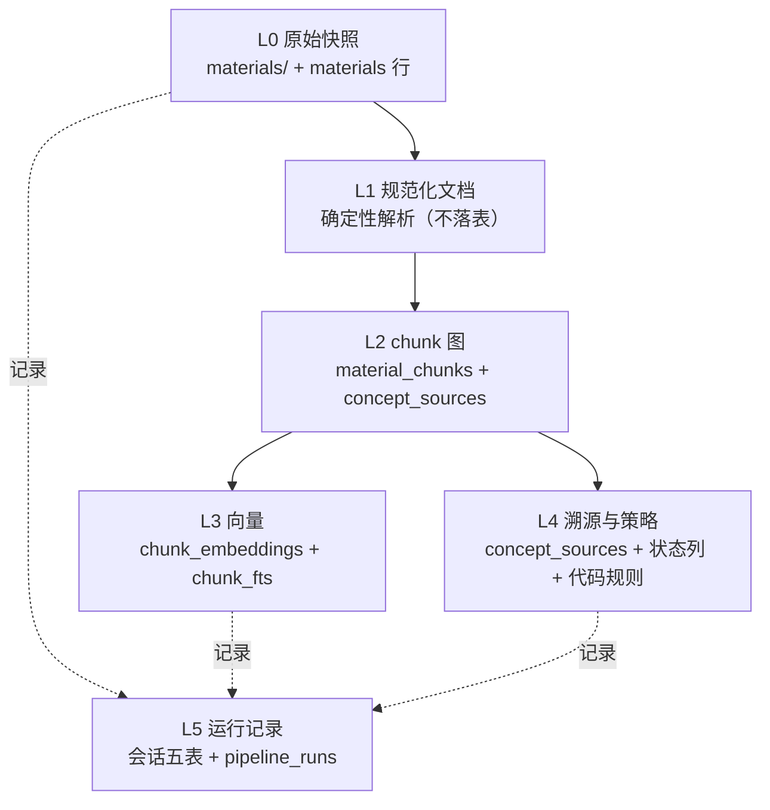

# 存储分层设计 v0.1

- 状态：DRAFT v0.1（2026-11-23）
- 父设计：`docs/designs/learning-companion-digital-human-v2.0.md`（FROZEN 2026-11-23）
- 依赖：`knowledge-ingestion-v0.1.md`（L0/L1/L2/L4 的内容表 schema）、`knowledge-retrieval-v0.1.md`（L3）、`agent-infrastructure-v0.1.md`（L5 会话表）
- 范围：L0–L5 的分层定义、表归属、写路径、重建矩阵、不变量；只新增 `pipeline_runs`、`hot_items`、`hot_fts` 三张表。
- 不范围：不改 v2.0 数据模型；不改入库/检索/agent 文档的既有表结构；本文档不含实现代码。

## 1. 要解决的具体问题

### 1.1 表面问题

同一份数据现在分散在文件、内容表、派生索引和会话表里，但"它属于哪一层、谁是真相源、删了能不能重建"没有统一说法：

- `materials.content_hash` 是 L0 的事实，但原文只在 `materials/` 里；
- `material_chunks` 同时承担 L1 的解析结果和 L2 的结构，层与层之间没有边界；
- `chunk_embeddings`/`chunk_fts` 是可重建派生数据，却和内容表同库同权限；
- 入库/抽取/确认/reindex 跑完后没有任何持久记录，只能翻终端。

### 1.2 目标

用 L0–L5 给每份数据一个确定的位置，并写清三件事：

1. 哪一层是真相源、哪一层可重建；
2. 哪个模块能写哪一层；
3. 每条不变量在哪一层生效。

### 1.3 明确不解决

- 不把 5 层做成 5 个物理库或 5 个文件；仍然是一个 `data/app.db` + 文件真相源（继承 KB-03）。
- 不引入 GraphRAG、通用边表、实体关系图。
- 不实现代码；`pipeline_runs` 只定 DDL 与语义，迁移与实现另排。

## 2. 分层定义



| 层 | 存什么 | 载体 | 真相源 | 可重建 | 写入口 |
|---|---|---|---|---|---|
| L0 原始快照 | 材料原始字节 + 来源 + 版本 | `materials/*.md\|*.html`（git）+ `materials` 行 | 文件（git 历史） | 否，只能 `git checkout` | 人工放置；`core.ingest` 只 upsert 行 |
| L1 规范化文档 | 解析后的正文 + 标题树 + token 计数 | 不落表；由 L0 确定性重放 | L0 | 是 | `core/ingestion.py`（内存） |
| L2 chunk 图 | 父子树 + 兄弟序 + 概念边 | `material_chunks` + `concept_sources` | L0（切块确定性） | 是 | `core/ingest.py`、`core/confirm.py` |
| L3 向量 | 子块向量 + 词法索引 | `chunk_embeddings` + `chunk_fts` | L2（纯派生） | 是 | `core.reindex.py` |
| L4 溯源与策略 | 出处、审核状态、可见性规则、未核实热项 | `concept_sources`、`question_cache`、`hot_items`/`hot_fts`、各状态列；规则在代码 | 混合（见 §3.5） | 部分 | `core/confirm.py`、`core/store.py`、`core/hot.py` |
| L5 运行记录 | 会话/评分/管线运行 | `agent_sessions`、`sessions`、`session_concepts`、`session_questions`、`misconceptions`、`pipeline_runs`（新） | 事件本身 | 否 | `core/store.py` |

## 3. 逐层规范

### 3.1 L0 原始快照

载体：`materials/` 下的文件是原始字节；`materials` 行是这套字节的登记簿。

| 字段 | 作用 |
|---|---|
| `id` | 文件名 slug，改名按 `content_hash` 识别为同一材料 |
| `path` | `materials/xxx.md`，唯一 |
| `format` | `md` / `html` |
| `content_hash` | 原始字节 SHA-256，版本键 |
| `version` | 从 1 开始，哈希变化 +1 |
| `added_at` | 首次入库时间 |
| `status` | `active` / `missing` |
| `source_url` | 网页出处；无出处用 `local://<相对路径>` |
| `tags_json` | 材料标签 |

不变量：

- IN-L0-1：`content_hash` 变化 → `version + 1`，旧版本块与旧向量保留，不删除。
- IN-L0-2：文件消失 → `status='missing'`，行不删；其概念按 KB-10 置 `orphaned`。
- IN-L0-3：同一 path 且 `content_hash` 未变 → 跳过，不产生新版本；同字节出现在新路径且旧路径仍存在时，按新材料的 v1 建行（只有旧路径消失才按哈希识别为改名）。

已知缺口：KB-02（`materials/` 进私有 git）尚未落地。落地前 L0 只有哈希，没有持久字节；文件丢失后无法复现当时的抽取。这条作为 §8 开放问题 1 跟踪。

明确不做：原始字节进 DB（保持 KB-12）；网页自动抓取快照（KB-06 只做人工落盘）。

### 3.2 L1 规范化文档

定义：L0 字节 → 解析（Markdown ATX 标题树/段落，或 HTML `<article>`/`<main>`）→ 规范化正文 + 标题树 + `count_tokens()` 计数。它是切块的输入。

不落表的理由：给定同一份 L0 字节、同一版解析器与切块参数、同一个 `count_tokens()` 实现，L1 的产出是确定的。再存一份规范化正文只会与 `material_chunks` 冗余。

可重放条件（三件套）：

1. L0 字节（由 `content_hash` 与版本唯一定位）；
2. 解析器与切块参数（随代码走 git）；
3. `count_tokens()` 实现（字符近似，KB-21）。

代价：解析器或切块参数变化后，旧版本的切块不能逐字节复现。接受这个代价，因为旧版本的 `material_chunks` 行本身保留，对比新旧切块用块行即可，不需要重建 L1。

元数据：L1 的可重放版本不单独存，随 L5 `pipeline_runs.stats_json.code_version` 记录当次 ingest 的代码版本。

明确不做：`material_documents` 表；解析中间产物落盘。

### 3.3 L2 chunk 图

节点 = `material_chunks` 行。边只有四种，全部来自现有字段：

| 边 | 字段 | 语义 |
|---|---|---|
| 父子边 | `parent_id` | 子块 → 父块；父块为 NULL |
| 兄弟序 | `ordinal` | 同级顺序，切块与合并用 |
| 结构路径 | `heading_path` | 如 `3. 工具调用 > 3.2 参数`，隐含祖先链 |
| 概念边 | `concept_sources(concept_id, chunk_id)` | 概念 → 子块；摘录与主出处 |

块 id 格式：`<material>-v<version>-<parent|child>-<ordinal>`，版本在 id 内，重建不会覆盖旧块 id。

不变量：

- IN-L2-1：子块 `parent_id` 非空，且指向同 `material_id` + `material_version` 的父块。
- IN-L2-2：同一父块下子块 `ordinal` 唯一；父块同级 `ordinal` 唯一（由切块保证 + 测试，DB 不强制）。
- IN-L2-3：块文本不为空；`token_count` 由 `count_tokens()` 计算。
- IN-L2-4：检索只用 `material_version = materials.version` 且 `materials.status='active'` 的块。

明确不做：通用边表 `chunk_edges`；跨块引用边；语义近邻边；块级 TTL。

### 3.4 L3 向量

载体：

```sql
chunk_embeddings (chunk_id PK, model, dim, vector BLOB, created_at)
chunk_fts USING fts5(chunk_id, material_id, material_version, text, tokenize='trigram')
```

不变量：

- IN-L3-1：只对子块建向量；父块不索引。
- IN-L3-2：向量行按 `model`/`dim` 存；与当前配置不匹配的行不参与检索。
- IN-L3-3：两张表都可 `DROP`，由 `python -m core.reindex` 重建；删除不影响 L0/L2/L4/L5。
- IN-L3-4：`core.ingest` 不写 L3（KR-07）；索引构建只走 `core.reindex`。

重建语义：

- `core.reindex`：全量重建 `chunk_fts`，补缺失 `chunk_embeddings`；
- `core.reindex --fts-only`：只重建 FTS；
- 换 embedding 模型 = 改配置 + 全量 reindex；旧向量保留但不参与。

### 3.5 L4 溯源与策略

L4 是唯一"半数据半代码"的层。数据部分：

| 溯源链 | 载体 | 保证 |
|---|---|---|
| 概念 → 原文 | `concept_sources`（`excerpt` 逐字 + `is_primary`） | 每个 active 概念至少一条；至多一条 `is_primary=1` |
| 题目 → 概念/出处 | `question_bank.source_url/source_excerpt` | 非空；能逐字在 L2 原文找到 |
| 会话题目 → 出处 | `session_questions.source_url/source_excerpt` | 落库后不依赖日志即可回放 |
| 题目审核 | `question_cache.review_status/reviewer/reason` | 状态机见下 |

策略部分一律是**代码规则**，不建策略表：

| 策略 | 规则 | 所在 |
|---|---|---|
| 检索可见性 | 只用最新版本 + `materials.status='active'` | `core/retrieval.py`（KR-03） |
| 概念可用性 | 只从 `concepts.status='active'` 出题 | Coach / `core/store.py` |
| 题目审核状态机 | `pending → passed/flagged → promoted/rejected/rolled_back` | 入库文档 §6.3（KB-18） |
| 缓存保留 | `question_cache` 保留 30 天，`flagged` 留到人工处理 | 入库文档 §6.3 |
| 材料缺失 | `status='missing'` → 概念 `orphaned` | 入库文档 §5.4（KB-10） |

不建 `policies` 表的理由：单用户本地应用没有多租户、多策略并行或运行时改策略的需求；策略随代码进 git，本身就是可审计、可回滚的。

不变量：

- IN-L4-1：任一 active 概念至少一条 `concept_sources`，至多一条 `is_primary=1`。
- IN-L4-2：任一道题（含生成与手写）必须带 `source_url` + `source_excerpt`，指不到出处就不出题。
- IN-L4-3：`session_questions` 落库后保留题目、回答、分数、反馈、出处，可独立回放。
- IN-L4-4：`hot_items` 永不写 `concept_sources`，永不作为计分题出处。

未核实热项（旁路）：`hot_items` + `hot_fts` 是 L4 的未核实缓冲区，完整设计见 `realtime-knowledge-v0.1.md`。边界：

- 只存用户输入与问题文本，不存 agent 生成内容；
- `status != 'hot'` 或已过期不参与检索；
- 晋升只能落成 `materials/inbox/*.md`，再走 L0 → L2 → L4 正常管线；
- 不建 hot 向量，检索只走 FTS trigram（RT-05）。

明确不做：策略表、TTL/敏感级/可见性字段、多租户隔离。

### 3.6 L5 运行记录

会话侧（已存在，归属 agent 文档，本文档只登记分层）：`agent_sessions`、`sessions`、`session_concepts`、`session_questions`、`misconceptions`。

管线侧（新增唯一一张表）：

```sql
CREATE TABLE IF NOT EXISTS pipeline_runs (
  id INTEGER PRIMARY KEY AUTOINCREMENT,
  kind TEXT NOT NULL CHECK (kind IN ('ingest','extract','confirm','reindex')),
  started_at TEXT NOT NULL,
  finished_at TEXT,
  status TEXT NOT NULL CHECK (status IN ('running','succeeded','failed','partial')),
  input TEXT,              -- 归一化输入标识（相对路径），不存绝对路径
  stats_json TEXT,         -- 见下表
  error TEXT
);
CREATE INDEX IF NOT EXISTS idx_pipeline_runs_kind_started
  ON pipeline_runs(kind, started_at);
```

`stats_json` 字段约定：

| kind | 字段 |
|---|---|
| `ingest` | `files`、`materials`、`chunks_parent`、`chunks_child`、`skipped_unchanged`、`failed`、`code_version` |
| `extract` | `parents`、`candidates`、`passed`、`flagged`、`discarded`、`failed`、`code_version` |
| `confirm` | `candidates`、`active`、`known`、`skipped`、`yaml_written`、`replayed`、`code_version` |
| `reindex` | `fts_rows`、`embedded`、`skipped`、`failed`、`code_version` |

写语义：

- `start_pipeline_run(kind, input)` 先独立提交一行 `status='running'`；`finish_pipeline_run(id, status, stats, error)` 更新收尾。run 行不参与管线的业务事务，避免长事务锁库。
- 进程异常退出会留下 `running` 行；下一次同类 `kind` 启动时，把残留 `running` 置为 `failed`、`error='aborted'`。
- 全部成功 → `succeeded`；有跳过但整批可用 → `partial`；整批不可用 → `failed`。
- `code_version` 取 `git rev-parse --short HEAD`，工作区脏时加 `-dirty`；非 git 检出记 `null`。

不变量：

- IN-L5-1：`pipeline_runs` 只追加；除 `finished_at`/`status`/`stats_json`/`error` 外不改字段。
- IN-L5-2：run 记录不是真相源，删除它不影响 L0–L4 的任何数据。
- IN-L5-3：`pipeline_runs` 不存日志正文、不存 key、不存绝对路径。

迁移：`SCHEMA_VERSION` 3 → 4，`MIGRATIONS[4] = PIPELINE_SCHEMA_SQL`，只做加法。

明确不做：run 的父子/嵌套关系、自动清理、运行日志入库、指标聚合表。

## 4. 写路径与事务边界

| 操作 | 写 L0 | 写 L2 | 写 L3 | 写 L4 | 写 L5 | 事务 |
|---|---|---|---|---|---|---|
| 人工放置材料 | 文件 | — | — | — | — | — |
| `core.ingest` | upsert `materials` 行 | upsert 块 | 不写 | 不写 | run 行 | 行+块单事务；run 独立 |
| `core.extract` | 只读 | 只读 | 只读 | 只读 | run 行 | run 独立 + 候选 JSON |
| `core.confirm` | 只读 | 只读 | 不写 | `concept_sources` + `concepts.status` | run 行 | YAML 先写；DB 单事务；run 独立 |
| `core.reindex` | 只读 | 只读 | 全量 FTS + 增量向量 | 不写 | run 行 | 每批独立；run 独立 |
| 会话（agent） | — | — | 只读 | 只读 | 逐题 + 结算 | 逐题 commit；结算单事务 |

写入口唯一：所有 DB 写入都由 `core/store.py` 暴露的方法完成。BFF 不直接写 SQL（继承 agent 文档 §6.1）。

## 5. 重建矩阵

| 层 | 删除后果 | 重建方式 | 依赖 | 成本 |
|---|---|---|---|---|
| L0 | 丢失内容真相 | `git checkout`（需 KB-02 已落地） | git | 无 |
| L1 | 无（不落表） | 重跑 `core.ingest --dry-run` | L0 + 代码版本 | 无 API 成本 |
| L2 | 丢失块与出处 | 删除该材料的块行与 `materials` 行后重跑 `core.ingest`；同哈希重跑会被跳过（IN-L0-3），当前 CLI 无 `--force` | L0；块 id 确定性，`concept_sources` 可继续指向 | 无 API 成本 |
| L3 | 检索不可用，会话退回旧题 | `core.reindex` | L2 + embedding API | 按块数计费 |
| L4 | 出处、审核状态与热项丢失 | `concept_sources` 由 `core.confirm --reapply` 重放；`hot_items` 与审核状态不可重建 | 候选归档 | 人工 |
| L5 | 审计与会话历史丢失 | 不可重建 | — | — |

重建顺序固定：L0 → L2 → L3；L4 依赖 L2 的块 id；L5 只记录过程，不参与重建。

## 6. 不变量总表

| ID | 层 | 断言 | 验证 |
|---|---|---|---|
| IN-L0-1 | L0 | 哈希变 → 版本 +1，旧块保留 | `tests/test_ingestion.py` |
| IN-L0-2 | L0 | 文件消失 → `missing`，行不删 | 待补 |
| IN-L0-3 | L0 | 同哈希 ingest 幂等 | 待补 |
| IN-L2-1 | L2 | 子块父指针同材料同版本 | `tests/test_ingestion.py` |
| IN-L2-2 | L2 | 同级 `ordinal` 唯一 | 切块测试 |
| IN-L2-4 | L2 | 检索只用最新 active 版本 | `tests/test_retrieval.py` |
| IN-L3-1 | L3 | 只对子块建向量 | `tests/test_embedding.py` |
| IN-L3-3 | L3 | L3 可删可重建 | `tests/test_pipeline.py` |
| IN-L3-4 | L3 | ingest 不写 L3 | `tests/test_pipeline.py` |
| IN-L4-1 | L4 | 每 active 概念至多一条主摘录 | `tests/test_confirm.py` |
| IN-L4-2 | L4 | 题目必带出处 | `tests/test_store.py` |
| IN-L4-4 | L4 | hot 不入 `concept_sources`、不作计分题出处 | 待补（RT-T04） |
| IN-L5-1 | L5 | run 只追加 | 待补（`pipeline_runs` 未实现） |
| IN-L5-2 | L5 | 删 run 不影响其他层 | 待补 |

## 7. 设计决策记录

规则沿用其他子设计：只追加；ID 用 `SL-01…`；状态 `accepted` / `superseded` / `revisit`。

| ID | 日期 | 决策 | 背景 | 备选 | 影响 | 状态 |
|---|---|---|---|---|---|---|
| SL-01 | 2026-11-23 | 5 层是逻辑分层，不物理分库；全部落 `data/app.db` + 文件真相源 | 继承 KB-03；跨表 join 与单事务需要同库 | 分层分库 / 每层一个文件 | 备份仍是一个 DB + git | accepted |
| SL-02 | 2026-11-23 | L0 不把字节存进 DB；真相源是 `materials/` + git + `materials` 行 | 继承 KB-12；字节进 DB 会让备份与 diff 变笨重 | 内容寻址 blob 表 | L0 依赖 KB-02 落地才有持久字节 | accepted |
| SL-03 | 2026-11-23 | L1 不落表，按"L0 字节 + 代码版本 + `count_tokens`"确定性重放 | 与 `material_chunks` 冗余；旧块行已保留，可对比 | `material_documents` 表 | 解析器版本变化后旧切块不可逐字节复现，接受 | accepted |
| SL-04 | 2026-11-23 | L2 就是两级树：父子边 + 兄弟序 + 结构路径 + 概念边，不建通用边表 | 当前只有父子关系是真实存在的；其余是假想需求 | `chunk_edges` 通用边表 / 只显式化 overlap | 将来要跨块引用再加法迁移 | accepted |
| SL-05 | 2026-11-23 | L4 的策略是代码规则，不建策略表 | 单用户本地应用；策略随代码进 git，天然可审计可回滚 | `policies` 表 / 配置化策略 | 改策略要改代码，不能运行时热改 | accepted |
| SL-06 | 2026-11-23 | L5 新增唯一一张表 `pipeline_runs`，只写不读，先当审计 | 管线运行目前只有 stdout；reindex/confirm 成本与不可回滚性最高 | 不记录 / 只记 reindex+confirm | `SCHEMA_VERSION` 3 → 4；每条管线多一次独立写 | accepted |
| SL-07 | 2026-11-23 | `pipeline_runs` 记录 `code_version`，承担 L1 可重放的版本元数据 | L1 不落表，需要知道当时用的是哪版解析器 | 单独 `code_versions` 表 / 不记录 | 依赖 git 环境；非 git 检出记 null | accepted |
| SL-08 | 2026-11-23 | 写入口仍然唯一：`core/store.py`；`pipeline_runs` 的 start/finish 也由它暴露 | 继承 agent 文档 §6.1 的写边界 | 管线自己开连接写 | BFF 与 CLI 都只调 Store | accepted |
| SL-09 | 2026-11-23 | `hot_items`/`hot_fts` 归 L4，是未核实缓冲区；晋升只能经 `materials/inbox/` 走正常管线 | 实时热项带来源与过期策略，但不是已核实内容，也不属于运行日志 | 归 L5 / 单独第 6 层 / 直接进 L0 | 主库内容边界不变；会话可即时用未核实热点 | accepted |
| SL-10 | 2026-11-23 | hot 检索只走 FTS trigram，不建 `hot_embeddings` | 目标 <500 条，查询是用户原话；向量收益不足以抵消多一张派生表 | 建 hot 向量 / 复用 chunk 向量 | 语义同义改写会漏；量上来再评估 | accepted（revisit） |

## 8. 开放问题与风险

1. **KB-02 未落地**：`materials/` 仍被 gitignore，L0 目前只有哈希没有持久字节。这是整份设计里唯一的硬缺口，必须先拍板内容进 git。
2. **L1 可重放未验证**：需要一次"改切块参数 → 重跑 → 对比块行"的实验，确认 L2 与 L1 的确定性边界。
3. **`pipeline_runs` 保留策略**：单次 run 行很小，先不清理；材料量上来后再定按天/按月清理。
4. **概念边归属**：`concept_sources` 同时是 L2 的边和 L4 的溯源，本文档统一归 L4，L2 只引用。如果后续出现"块↔块"关系，再考虑移动。
5. **L3 规模临界点**：numpy 暴力在 1 万子块内够用；超过后评估 sqlite-vec/ANN（继承 KR-02）。
6. **`pipeline_runs` 与业务事务的边界**：run 行独立提交意味着进程崩溃时业务可能已提交而 run 仍是 `running`；由下一次同类 run 收尾，不保证精确计数。

## 9. 与现有文档的关系

- 优先级：v2.0 > `knowledge-ingestion` / `knowledge-retrieval` / `agent-infrastructure` > 本文档 > 技术方案。本文档只做分层与归属，不改变任何既有硬约束。
- 本文档拥有：L0–L5 的定义、层间不变量、重建矩阵、`pipeline_runs` 的 DDL 与写语义。
- 本文档不拥有：`materials`/`material_chunks`/`concept_sources`/`question_cache` 的字段定义（入库文档 §5.3）；`chunk_embeddings`/`chunk_fts`（检索文档 §5）；会话五表（agent 文档 §5.2）。
- `pipeline_runs` 是 v2.0 数据模型之外的加法运行时表，按 `agent_sessions` 先例在 `FREEZE.md` 登记。
- 实现顺序：先 `pipeline_runs` 迁移与 Store 方法，再让四条管线接入；本文档不重排 v0/v1 任务。
